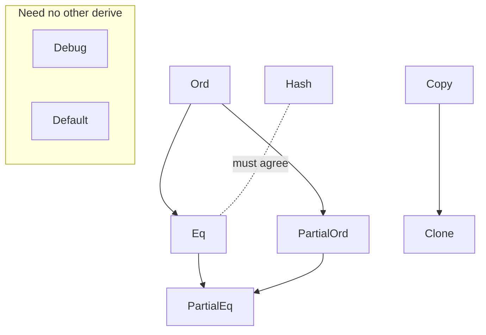

# Lesson 2 — Structs, Enums, Traits and Generics

The one idea: **a derive or a trait bound is a promise, and the compiler holds you to the promise you wrote, not the one you meant.**

## Goals and outcomes

By the end of the lesson, you should be able to:

1. Model data with a struct, a **newtype** (`struct ItemId(usize)`) or an **enum whose variants carry data**, and say why you picked it.
2. Say what each common derive (`Debug`, `Clone`, `Copy`, `PartialEq`, `Eq`, `Hash`, `PartialOrd`, `Ord`, `Default`) promises, and which ones need another.
3. Write `Display` and `Default` by hand, and explain why `#[derive(Default)]` on a generic type can be the wrong choice.
4. Add the **smallest trait bound** that makes generic code compile, and put it on the `impl` or method that needs it rather than on the struct.
5. Read a supertrait with an associated const (`trait NamedScorer: Scorer + Default { const NAME: &'static str; }`) and say what an implementer must provide.

## About this document

The reading is copied from *The Rust Programming Language*:

- Chapter 5, "Using Structs to Structure Related Data"
- Chapter 6, "Enums and Pattern Matching"
- Chapter 10.1–10.2, "Generic Data Types" and "Traits: Defining Shared Behavior" (10.3, lifetimes, is not assigned)
- Appendix C, "Derivable Traits"

The text comes from [rust-lang/book](https://github.com/rust-lang/book) at commit
[`1500248d8f23`](https://github.com/rust-lang/book/tree/1500248d8f23/src), with the code listings
inlined. A comment above each section links to its source file. For the live version, see
<https://doc.rust-lang.org/book/>.

The lecture notes are callouts marked **Lesson notes**, placed where the reading covers the same
topic. Two topics get sections of their own:
[which derives need which](#lesson-notes-which-derives-need-which), at the start of Appendix C, and
[supertraits and associated consts](#lesson-notes-supertraits-and-associated-consts), which the
reading doesn't cover, at the end of Chapter 10. The [FAQ](#faq) comes last.

<!-- Source: https://github.com/rust-lang/book/blob/1500248d8f23/src/ch05-00-structs.md -->

## Using Structs to Structure Related Data

A _struct_, or _structure_, is a custom data type that lets you package
together and name multiple related values that make up a meaningful group. If
you’re familiar with an object-oriented language, a struct is like an object’s
data attributes. In this chapter, we’ll compare and contrast tuples with
structs to build on what you already know and demonstrate when structs are a
better way to group data.

We’ll demonstrate how to define and instantiate structs. We’ll discuss how to
define associated functions, especially the kind of associated functions called
_methods_, to specify behavior associated with a struct type. Structs and enums
(discussed in Chapter 6) are the building blocks for creating new types in your
program’s domain to take full advantage of Rust’s compile-time type checking.

<!-- Source: https://github.com/rust-lang/book/blob/1500248d8f23/src/ch05-01-defining-structs.md -->

### Defining and Instantiating Structs

Structs are similar to tuples, discussed in [“The Tuple Type”](https://doc.rust-lang.org/book/ch03-02-data-types.html#the-tuple-type) section, in that both hold multiple related values. Like tuples, the
pieces of a struct can be different types. Unlike with tuples, in a struct
you’ll name each piece of data so it’s clear what the values mean. Adding these
names means that structs are more flexible than tuples: You don’t have to rely
on the order of the data to specify or access the values of an instance.

To define a struct, we enter the keyword `struct` and name the entire struct. A
struct’s name should describe the significance of the pieces of data being
grouped together. Then, inside curly brackets, we define the names and types of
the pieces of data, which we call _fields_. For example, Listing 5-1 shows a
struct that stores information about a user account.

Filename: src/main.rs

```rust
struct User {
    active: bool,
    username: String,
    email: String,
    sign_in_count: u64,
}
```

**Listing 5-1:** A `User` struct definition

To use a struct after we’ve defined it, we create an _instance_ of that struct
by specifying concrete values for each of the fields. We create an instance by
stating the name of the struct and then add curly brackets containing _`key:
value`_ pairs, where the keys are the names of the fields and the values are the
data we want to store in those fields. We don’t have to specify the fields in
the same order in which we declared them in the struct. In other words, the
struct definition is like a general template for the type, and instances fill
in that template with particular data to create values of the type. For
example, we can declare a particular user as shown in Listing 5-2.

Filename: src/main.rs

```rust
fn main() {
    let user1 = User {
        active: true,
        username: String::from("someusername123"),
        email: String::from("someone@example.com"),
        sign_in_count: 1,
    };
}
```

**Listing 5-2:** Creating an instance of the `User` struct

To get a specific value from a struct, we use dot notation. For example, to
access this user’s email address, we use `user1.email`. If the instance is
mutable, we can change a value by using the dot notation and assigning into a
particular field. Listing 5-3 shows how to change the value in the `email`
field of a mutable `User` instance.

Filename: src/main.rs

```rust
fn main() {
    let mut user1 = User {
        active: true,
        username: String::from("someusername123"),
        email: String::from("someone@example.com"),
        sign_in_count: 1,
    };

    user1.email = String::from("anotheremail@example.com");
}
```

**Listing 5-3:** Changing the value in the `email` field of a `User` instance

Note that the entire instance must be mutable; Rust doesn’t allow us to mark
only certain fields as mutable. As with any expression, we can construct a new
instance of the struct as the last expression in the function body to
implicitly return that new instance.

Listing 5-4 shows a `build_user` function that returns a `User` instance with
the given email and username. The `active` field gets the value `true`, and the
`sign_in_count` gets a value of `1`.

Filename: src/main.rs

```rust
fn build_user(email: String, username: String) -> User {
    User {
        active: true,
        username: username,
        email: email,
        sign_in_count: 1,
    }
}
```

**Listing 5-4:** A `build_user` function that takes an email and username and returns a `User` instance

It makes sense to name the function parameters with the same name as the struct
fields, but having to repeat the `email` and `username` field names and
variables is a bit tedious. If the struct had more fields, repeating each name
would get even more annoying. Luckily, there’s a convenient shorthand!

#### Using the Field Init Shorthand

Because the parameter names and the struct field names are exactly the same in
Listing 5-4, we can use the _field init shorthand_ syntax to rewrite
`build_user` so that it behaves exactly the same but doesn’t have the
repetition of `username` and `email`, as shown in Listing 5-5.

Filename: src/main.rs

```rust
fn build_user(email: String, username: String) -> User {
    User {
        active: true,
        username,
        email,
        sign_in_count: 1,
    }
}
```

**Listing 5-5:** A `build_user` function that uses field init shorthand because the `username` and `email` parameters have the same name as struct fields

Here, we’re creating a new instance of the `User` struct, which has a field
named `email`. We want to set the `email` field’s value to the value in the
`email` parameter of the `build_user` function. Because the `email` field and
the `email` parameter have the same name, we only need to write `email` rather
than `email: email`.

#### Creating Instances with Struct Update Syntax

It’s often useful to create a new instance of a struct that includes most of
the values from another instance of the same type, but changes some of them.
You can do this using struct update syntax.

First, in Listing 5-6 we show how to create a new `User` instance in `user2` in
the regular way, without the update syntax. We set a new value for `email` but
otherwise use the same values from `user1` that we created in Listing 5-2.

Filename: src/main.rs

```rust
fn main() {
    let user2 = User {
        active: user1.active,
        username: user1.username,
        email: String::from("another@example.com"),
        sign_in_count: user1.sign_in_count,
    };
}
```

**Listing 5-6:** Creating a new `User` instance using all but one of the values from `user1`

Using struct update syntax, we can achieve the same effect with less code, as
shown in Listing 5-7. The syntax `..` specifies that the remaining fields not
explicitly set should have the same value as the fields in the given instance.

Filename: src/main.rs

```rust
fn main() {
    let user2 = User {
        email: String::from("another@example.com"),
        ..user1
    };
}
```

**Listing 5-7:** Using struct update syntax to set a new `email` value for a `User` instance but to use the rest of the values from `user1`

The code in Listing 5-7 also creates an instance in `user2` that has a
different value for `email` but has the same values for the `username`,
`active`, and `sign_in_count` fields from `user1`. The `..user1` must come last
to specify that any remaining fields should get their values from the
corresponding fields in `user1`, but we can choose to specify values for as
many fields as we want in any order, regardless of the order of the fields in
the struct’s definition.

Note that the struct update syntax uses `=` like an assignment; this is because
it moves the data, just as we saw in the [“Variables and Data Interacting with
Move”](https://doc.rust-lang.org/book/ch04-01-what-is-ownership.html#variables-and-data-interacting-with-move) section. In this example, we can no longer use
`user1` after creating `user2` because the `String` in the `username` field of
`user1` was moved into `user2`. If we had given `user2` new `String` values for
both `email` and `username`, and thus only used the `active` and `sign_in_count`
values from `user1`, then `user1` would still be valid after creating `user2`.
Both `active` and `sign_in_count` are types that implement the `Copy` trait, so
the behavior we discussed in the [“Stack-Only Data: Copy”](https://doc.rust-lang.org/book/ch04-01-what-is-ownership.html#stack-only-data-copy)
section would apply. We can also still use `user1.email` in this example,
because its value was not moved out of `user1`.

#### Creating Different Types with Tuple Structs

Rust also supports structs that look similar to tuples, called _tuple structs_.
Tuple structs have the added meaning the struct name provides but don’t have
names associated with their fields; rather, they just have the types of the
fields. Tuple structs are useful when you want to give the whole tuple a name
and make the tuple a different type from other tuples, and when naming each
field as in a regular struct would be verbose or redundant.

To define a tuple struct, start with the `struct` keyword and the struct name
followed by the types in the tuple. For example, here we define and use two
tuple structs named `Color` and `Point`:

Filename: src/main.rs

```rust
struct Color(i32, i32, i32);
struct Point(i32, i32, i32);

fn main() {
    let black = Color(0, 0, 0);
    let origin = Point(0, 0, 0);
}
```

Note that the `black` and `origin` values are different types because they’re
instances of different tuple structs. Each struct you define is its own type,
even though the fields within the struct might have the same types. For
example, a function that takes a parameter of type `Color` cannot take a
`Point` as an argument, even though both types are made up of three `i32`
values. Otherwise, tuple struct instances are similar to tuples in that you can
destructure them into their individual pieces, and you can use a `.` followed
by the index to access an individual value. Unlike tuples, tuple structs
require you to name the type of the struct when you destructure them. For
example, we would write `let Point(x, y, z) = origin;` to destructure the
values in the `origin` point into variables named `x`, `y`, and `z`.

> [!NOTE]
> **Lesson notes: newtypes.** A tuple struct with one field is called a *newtype*. It costs
> nothing at runtime, but it stops you passing a `UserId` where an `OrderId` belongs. 
>
> ```rust
> #[derive(Clone, Copy, Debug, PartialEq, Eq, Hash, PartialOrd, Ord)]
> struct UserId(u32);   // a u32 that can't be mixed up with other u32s
> ```

#### Defining Unit-Like Structs

You can also define structs that don’t have any fields! These are called
_unit-like structs_ because they behave similarly to `()`, the unit type that
we mentioned in [“The Tuple Type”](https://doc.rust-lang.org/book/ch03-02-data-types.html#the-tuple-type) section. Unit-like
structs can be useful when you need to implement a trait on some type but don’t
have any data that you want to store in the type itself. We’ll discuss traits
in Chapter 10. Here’s an example of declaring and instantiating a unit struct
named `AlwaysEqual`:

Filename: src/main.rs

```rust
struct AlwaysEqual;

fn main() {
    let subject = AlwaysEqual;
}
```

To define `AlwaysEqual`, we use the `struct` keyword, the name we want, and
then a semicolon. No need for curly brackets or parentheses! Then, we can get
an instance of `AlwaysEqual` in the `subject` variable in a similar way: using
the name we defined, without any curly brackets or parentheses. Imagine that
later we’ll implement behavior for this type such that every instance of
`AlwaysEqual` is always equal to every instance of any other type, perhaps to
have a known result for testing purposes. We wouldn’t need any data to
implement that behavior! You’ll see in Chapter 10 how to define traits and
implement them on any type, including unit-like structs.

> ### Ownership of Struct Data
>
> In the `User` struct definition in Listing 5-1, we used the owned `String`
> type rather than the `&str` string slice type. This is a deliberate choice
> because we want each instance of this struct to own all of its data and for
> that data to be valid for as long as the entire struct is valid.
>
> It’s also possible for structs to store references to data owned by something
> else, but to do so requires the use of _lifetimes_, a Rust feature that we’ll
> discuss in Chapter 10. Lifetimes ensure that the data referenced by a struct
> is valid for as long as the struct is. Let’s say you try to store a reference
> in a struct without specifying lifetimes, like the following in
> *src/main.rs*; this won’t work:
>
> Filename: src/main.rs
>
> *This code does not compile!*
>
> ```rust
> struct User {
>     active: bool,
>     username: &str,
>     email: &str,
>     sign_in_count: u64,
> }
>
> fn main() {
>     let user1 = User {
>         active: true,
>         username: "someusername123",
>         email: "someone@example.com",
>         sign_in_count: 1,
>     };
> }
> ```
>
> The compiler will complain that it needs lifetime specifiers:
>
> ```console
> $ cargo run
>    Compiling structs v0.1.0 (file:///projects/structs)
> error[E0106]: missing lifetime specifier
>  --> src/main.rs:3:15
>   |
> 3 |     username: &str,
>   |               ^ expected named lifetime parameter
>   |
> help: consider introducing a named lifetime parameter
>   |
> 1 ~ struct User<'a> {
> 2 |     active: bool,
> 3 ~     username: &'a str,
>   |
>
> error[E0106]: missing lifetime specifier
>  --> src/main.rs:4:12
>   |
> 4 |     email: &str,
>   |            ^ expected named lifetime parameter
>   |
> help: consider introducing a named lifetime parameter
>   |
> 1 ~ struct User<'a> {
> 2 |     active: bool,
> 3 |     username: &str,
> 4 ~     email: &'a str,
>   |
>
> For more information about this error, try `rustc --explain E0106`.
> error: could not compile `structs` (bin "structs") due to 2 previous errors
> ```
>
> In Chapter 10, we’ll discuss how to fix these errors so that you can store
> references in structs, but for now, we’ll fix errors like these using owned
> types like `String` instead of references like `&str`.

<!-- Source: https://github.com/rust-lang/book/blob/1500248d8f23/src/ch05-02-example-structs.md -->

### An Example Program Using Structs

To understand when we might want to use structs, let’s write a program that
calculates the area of a rectangle. We’ll start by using single variables and
then refactor the program until we’re using structs instead.

Let’s make a new binary project with Cargo called _rectangles_ that will take
the width and height of a rectangle specified in pixels and calculate the area
of the rectangle. Listing 5-8 shows a short program with one way of doing
exactly that in our project’s _src/main.rs_.

Filename: src/main.rs

```rust
fn main() {
    let width1 = 30;
    let height1 = 50;

    println!(
        "The area of the rectangle is {} square pixels.",
        area(width1, height1)
    );
}

fn area(width: u32, height: u32) -> u32 {
    width * height
}
```

**Listing 5-8:** Calculating the area of a rectangle specified by separate width and height variables

Now, run this program using `cargo run`:

```console
$ cargo run
   Compiling rectangles v0.1.0 (file:///projects/rectangles)
    Finished `dev` profile [unoptimized + debuginfo] target(s) in 0.42s
     Running `target/debug/rectangles`
The area of the rectangle is 1500 square pixels.
```

This code succeeds in figuring out the area of the rectangle by calling the
`area` function with each dimension, but we can do more to make this code clear
and readable.

The issue with this code is evident in the signature of `area`:

```rust
fn area(width: u32, height: u32) -> u32 {
```

The `area` function is supposed to calculate the area of one rectangle, but the
function we wrote has two parameters, and it’s not clear anywhere in our
program that the parameters are related. It would be more readable and more
manageable to group width and height together. We’ve already discussed one way
we might do that in [“The Tuple Type”](https://doc.rust-lang.org/book/ch03-02-data-types.html#the-tuple-type) section
of Chapter 3: by using tuples.

#### Refactoring with Tuples

Listing 5-9 shows another version of our program that uses tuples.

Filename: src/main.rs

```rust
fn main() {
    let rect1 = (30, 50);

    println!(
        "The area of the rectangle is {} square pixels.",
        area(rect1)
    );
}

fn area(dimensions: (u32, u32)) -> u32 {
    dimensions.0 * dimensions.1
}
```

**Listing 5-9:** Specifying the width and height of the rectangle with a tuple

In one way, this program is better. Tuples let us add a bit of structure, and
we’re now passing just one argument. But in another way, this version is less
clear: Tuples don’t name their elements, so we have to index into the parts of
the tuple, making our calculation less obvious.

Mixing up the width and height wouldn’t matter for the area calculation, but if
we want to draw the rectangle on the screen, it would matter! We would have to
keep in mind that `width` is the tuple index `0` and `height` is the tuple
index `1`. This would be even harder for someone else to figure out and keep in
mind if they were to use our code. Because we haven’t conveyed the meaning of
our data in our code, it’s now easier to introduce errors.

#### Refactoring with Structs

We use structs to add meaning by labeling the data. We can transform the tuple
we’re using into a struct with a name for the whole as well as names for the
parts, as shown in Listing 5-10.

Filename: src/main.rs

```rust
struct Rectangle {
    width: u32,
    height: u32,
}

fn main() {
    let rect1 = Rectangle {
        width: 30,
        height: 50,
    };

    println!(
        "The area of the rectangle is {} square pixels.",
        area(&rect1)
    );
}

fn area(rectangle: &Rectangle) -> u32 {
    rectangle.width * rectangle.height
}
```

**Listing 5-10:** Defining a `Rectangle` struct

Here, we’ve defined a struct and named it `Rectangle`. Inside the curly
brackets, we defined the fields as `width` and `height`, both of which have
type `u32`. Then, in `main`, we created a particular instance of `Rectangle`
that has a width of `30` and a height of `50`.

Our `area` function is now defined with one parameter, which we’ve named
`rectangle`, whose type is an immutable borrow of a struct `Rectangle`
instance. As mentioned in Chapter 4, we want to borrow the struct rather than
take ownership of it. This way, `main` retains its ownership and can continue
using `rect1`, which is the reason we use the `&` in the function signature and
where we call the function.

The `area` function accesses the `width` and `height` fields of the `Rectangle`
instance (note that accessing fields of a borrowed struct instance does not
move the field values, which is why you often see borrows of structs). Our
function signature for `area` now says exactly what we mean: Calculate the area
of `Rectangle`, using its `width` and `height` fields. This conveys that the
width and height are related to each other, and it gives descriptive names to
the values rather than using the tuple index values of `0` and `1`. This is a
win for clarity.

#### Adding Functionality with Derived Traits

It’d be useful to be able to print an instance of `Rectangle` while we’re
debugging our program and see the values for all its fields. Listing 5-11 tries
using the [`println!` macro](https://doc.rust-lang.org/std/macro.println.html) as we have used in
previous chapters. This won’t work, however.

Filename: src/main.rs

*This code does not compile!*

```rust
struct Rectangle {
    width: u32,
    height: u32,
}

fn main() {
    let rect1 = Rectangle {
        width: 30,
        height: 50,
    };

    println!("rect1 is {rect1}");
}
```

**Listing 5-11:** Attempting to print a `Rectangle` instance

When we compile this code, we get an error with this core message:

```text
error[E0277]: `Rectangle` doesn't implement `std::fmt::Display`
```

The `println!` macro can do many kinds of formatting, and by default, the curly
brackets tell `println!` to use formatting known as `Display`: output intended
for direct end user consumption. The primitive types we’ve seen so far
implement `Display` by default because there’s only one way you’d want to show
a `1` or any other primitive type to a user. But with structs, the way
`println!` should format the output is less clear because there are more
display possibilities: Do you want commas or not? Do you want to print the
curly brackets? Should all the fields be shown? Due to this ambiguity, Rust
doesn’t try to guess what we want, and structs don’t have a provided
implementation of `Display` to use with `println!` and the `{}` placeholder.

If we continue reading the errors, we’ll find this helpful note:

```text
help: the trait `std::fmt::Display` is not implemented for `Rectangle`
  --> src/main.rs:1:1
```

Let’s try it! The `println!` macro call will now look like `println!("rect1 is
{rect1:?}");`. Putting the specifier `:?` inside the curly brackets tells
`println!` we want to use an output format called `Debug`. The `Debug` trait
enables us to print our struct in a way that is useful for developers so that
we can see its value while we’re debugging our code.

Compile the code with this change. Drat! We still get an error:

```text
error[E0277]: `Rectangle` doesn't implement `Debug`
```

But again, the compiler gives us a helpful note:

```text
|                        required by this formatting parameter
|
```

Rust _does_ include functionality to print out debugging information, but we
have to explicitly opt in to make that functionality available for our struct.
To do that, we add the outer attribute `#[derive(Debug)]` just before the
struct definition, as shown in Listing 5-12.

Filename: src/main.rs

```rust
#[derive(Debug)]
struct Rectangle {
    width: u32,
    height: u32,
}

fn main() {
    let rect1 = Rectangle {
        width: 30,
        height: 50,
    };

    println!("rect1 is {rect1:?}");
}
```

**Listing 5-12:** Adding the attribute to derive the `Debug` trait and printing the `Rectangle` instance using debug formatting

Now when we run the program, we won’t get any errors, and we’ll see the
following output:

```console
$ cargo run
   Compiling rectangles v0.1.0 (file:///projects/rectangles)
    Finished `dev` profile [unoptimized + debuginfo] target(s) in 0.48s
     Running `target/debug/rectangles`
rect1 is Rectangle { width: 30, height: 50 }
```

Nice! It’s not the prettiest output, but it shows the values of all the fields
for this instance, which would definitely help during debugging. When we have
larger structs, it’s useful to have output that’s a bit easier to read; in
those cases, we can use `{:#?}` instead of `{:?}` in the `println!` string. In
this example, using the `{:#?}` style will output the following:

```console
$ cargo run
   Compiling rectangles v0.1.0 (file:///projects/rectangles)
    Finished `dev` profile [unoptimized + debuginfo] target(s) in 0.48s
     Running `target/debug/rectangles`
rect1 is Rectangle {
    width: 30,
    height: 50,
}
```

Another way to print out a value using the `Debug` format is to use the [`dbg!`
macro](https://doc.rust-lang.org/std/macro.dbg.html), which takes ownership of an expression (as opposed
to `println!`, which takes a reference), prints the file and line number of
where that `dbg!` macro call occurs in your code along with the resultant value
of that expression, and returns ownership of the value.

> Note: Calling the `dbg!` macro prints to the standard error console stream
> (`stderr`), as opposed to `println!`, which prints to the standard output
> console stream (`stdout`). We’ll talk more about `stderr` and `stdout` in the
> [“Redirecting Errors to Standard Error” section in Chapter
> 12](https://doc.rust-lang.org/book/ch12-06-writing-to-stderr-instead-of-stdout.html).

Here’s an example where we’re interested in the value that gets assigned to the
`width` field, as well as the value of the whole struct in `rect1`:

```rust
#[derive(Debug)]
struct Rectangle {
    width: u32,
    height: u32,
}

fn main() {
    let scale = 2;
    let rect1 = Rectangle {
        width: dbg!(30 * scale),
        height: 50,
    };

    dbg!(&rect1);
}
```

We can put `dbg!` around the expression `30 * scale` and, because `dbg!`
returns ownership of the expression’s value, the `width` field will get the
same value as if we didn’t have the `dbg!` call there. We don’t want `dbg!` to
take ownership of `rect1`, so we use a reference to `rect1` in the next call.
Here’s what the output of this example looks like:

```console
$ cargo run
   Compiling rectangles v0.1.0 (file:///projects/rectangles)
    Finished `dev` profile [unoptimized + debuginfo] target(s) in 0.61s
     Running `target/debug/rectangles`
[src/main.rs:10:16] 30 * scale = 60
[src/main.rs:14:5] &rect1 = Rectangle {
    width: 60,
    height: 50,
}
```

We can see the first bit of output came from _src/main.rs_ line 10 where we’re
debugging the expression `30 * scale`, and its resultant value is `60` (the
`Debug` formatting implemented for integers is to print only their value). The
`dbg!` call on line 14 of _src/main.rs_ outputs the value of `&rect1`, which is
the `Rectangle` struct. This output uses the pretty `Debug` formatting of the
`Rectangle` type. The `dbg!` macro can be really helpful when you’re trying to
figure out what your code is doing!

In addition to the `Debug` trait, Rust has provided a number of traits for us
to use with the `derive` attribute that can add useful behavior to our custom
types. Those traits and their behaviors are listed in [Appendix C](https://doc.rust-lang.org/book/appendix-03-derivable-traits.html). We’ll cover how to implement these traits with custom behavior as
well as how to create your own traits in Chapter 10. There are also many
attributes other than `derive`; for more information, see [the “Attributes”
section of the Rust Reference](https://doc.rust-lang.org/reference/attributes.html).

> [!NOTE]
> **Lesson notes: derives are promises.** The compiler checks each derive against every field.
> [Which derives need which](#lesson-notes-which-derives-need-which), at the start of Appendix C,
> has a table of what each common derive promises and needs, and a diagram of how they depend on
> each other.

Our `area` function is very specific: It only computes the area of rectangles.
It would be helpful to tie this behavior more closely to our `Rectangle` struct
because it won’t work with any other type. Let’s look at how we can continue to
refactor this code by turning the `area` function into an `area` method
defined on our `Rectangle` type.

<!-- Source: https://github.com/rust-lang/book/blob/1500248d8f23/src/ch05-03-method-syntax.md -->

### Methods

Methods are similar to functions: We declare them with the `fn` keyword and a
name, they can have parameters and a return value, and they contain some code
that’s run when the method is called from somewhere else. Unlike functions,
methods are defined within the context of a struct (or an enum or a trait
object, which we cover in [Chapter 6](https://doc.rust-lang.org/book/ch06-00-enums.html) and [Chapter
18](https://doc.rust-lang.org/book/ch18-02-trait-objects.html), respectively), and their first parameter is
always `self`, which represents the instance of the struct the method is being
called on.

#### Method Syntax

Let’s change the `area` function that has a `Rectangle` instance as a parameter
and instead make an `area` method defined on the `Rectangle` struct, as shown
in Listing 5-13.

Filename: src/main.rs

```rust
#[derive(Debug)]
struct Rectangle {
    width: u32,
    height: u32,
}

impl Rectangle {
    fn area(&self) -> u32 {
        self.width * self.height
    }
}

fn main() {
    let rect1 = Rectangle {
        width: 30,
        height: 50,
    };

    println!(
        "The area of the rectangle is {} square pixels.",
        rect1.area()
    );
}
```

**Listing 5-13:** Defining an `area` method on the `Rectangle` struct

To define the function within the context of `Rectangle`, we start an `impl`
(implementation) block for `Rectangle`. Everything within this `impl` block
will be associated with the `Rectangle` type. Then, we move the `area` function
within the `impl` curly brackets and change the first (and in this case, only)
parameter to be `self` in the signature and everywhere within the body. In
`main`, where we called the `area` function and passed `rect1` as an argument,
we can instead use _method syntax_ to call the `area` method on our `Rectangle`
instance. The method syntax goes after an instance: We add a dot followed by
the method name, parentheses, and any arguments.

In the signature for `area`, we use `&self` instead of `rectangle: &Rectangle`.
The `&self` is actually short for `self: &Self`. Within an `impl` block, the
type `Self` is an alias for the type that the `impl` block is for. Methods must
have a parameter named `self` of type `Self` for their first parameter, so Rust
lets you abbreviate this with only the name `self` in the first parameter spot.
Note that we still need to use the `&` in front of the `self` shorthand to
indicate that this method borrows the `Self` instance, just as we did in
`rectangle: &Rectangle`. Methods can take ownership of `self`, borrow `self`
immutably, as we’ve done here, or borrow `self` mutably, just as they can any
other parameter.

We chose `&self` here for the same reason we used `&Rectangle` in the function
version: We don’t want to take ownership, and we just want to read the data in
the struct, not write to it. If we wanted to change the instance that we’ve
called the method on as part of what the method does, we’d use `&mut self` as
the first parameter. Having a method that takes ownership of the instance by
using just `self` as the first parameter is rare; this technique is usually
used when the method transforms `self` into something else and you want to
prevent the caller from using the original instance after the transformation.

The main reason for using methods instead of functions, in addition to
providing method syntax and not having to repeat the type of `self` in every
method’s signature, is for organization. We’ve put all the things we can do
with an instance of a type in one `impl` block rather than making future users
of our code search for capabilities of `Rectangle` in various places in the
library we provide.

Note that we can choose to give a method the same name as one of the struct’s
fields. For example, we can define a method on `Rectangle` that is also named
`width`:

Filename: src/main.rs

```rust
impl Rectangle {
    fn width(&self) -> bool {
        self.width > 0
    }
}

fn main() {
    let rect1 = Rectangle {
        width: 30,
        height: 50,
    };

    if rect1.width() {
        println!("The rectangle has a nonzero width; it is {}", rect1.width);
    }
}
```

Here, we’re choosing to make the `width` method return `true` if the value in
the instance’s `width` field is greater than `0` and `false` if the value is
`0`: We can use a field within a method of the same name for any purpose. In
`main`, when we follow `rect1.width` with parentheses, Rust knows we mean the
method `width`. When we don’t use parentheses, Rust knows we mean the field
`width`.

Often, but not always, when we give a method the same name as a field we want
it to only return the value in the field and do nothing else. Methods like this
are called _getters_, and Rust does not implement them automatically for struct
fields as some other languages do. Getters are useful because you can make the
field private but the method public and thus enable read-only access to that
field as part of the type’s public API. We will discuss what public and private
are and how to designate a field or method as public or private in [Chapter
7](https://doc.rust-lang.org/book/ch07-03-paths-for-referring-to-an-item-in-the-module-tree.html#exposing-paths-with-the-pub-keyword).

> ### Where’s the `->` Operator?
>
> In C and C++, two different operators are used for calling methods: You use
> `.` if you’re calling a method on the object directly and `->` if you’re
> calling the method on a pointer to the object and need to dereference the
> pointer first. In other words, if `object` is a pointer,
> `object->something()` is similar to `(*object).something()`.
>
> Rust doesn’t have an equivalent to the `->` operator; instead, Rust has a
> feature called _automatic referencing and dereferencing_. Calling methods is
> one of the few places in Rust with this behavior.
>
> Here’s how it works: When you call a method with `object.something()`, Rust
> automatically adds in `&`, `&mut`, or `*` so that `object` matches the
> signature of the method. In other words, the following are the same:
>
> ```rust
> # #[derive(Debug,Copy,Clone)]
> # struct Point {
> #     x: f64,
> #     y: f64,
> # }
> #
> # impl Point {
> #    fn distance(&self, other: &Point) -> f64 {
> #        let x_squared = f64::powi(other.x - self.x, 2);
> #        let y_squared = f64::powi(other.y - self.y, 2);
> #
> #        f64::sqrt(x_squared + y_squared)
> #    }
> # }
> # let p1 = Point { x: 0.0, y: 0.0 };
> # let p2 = Point { x: 5.0, y: 6.5 };
> p1.distance(&p2);
> (&p1).distance(&p2);
> ```
>
> The first one looks much cleaner. This automatic referencing behavior works
> because methods have a clear receiver—the type of `self`. Given the receiver
> and name of a method, Rust can figure out definitively whether the method is
> reading (`&self`), mutating (`&mut self`), or consuming (`self`). The fact
> that Rust makes borrowing implicit for method receivers is a big part of
> making ownership ergonomic in practice.

#### Methods with More Parameters

Let’s practice using methods by implementing a second method on the `Rectangle`
struct. This time we want an instance of `Rectangle` to take another instance
of `Rectangle` and return `true` if the second `Rectangle` can fit completely
within `self` (the first `Rectangle`); otherwise, it should return `false`.
That is, once we’ve defined the `can_hold` method, we want to be able to write
the program shown in Listing 5-14.

Filename: src/main.rs

```rust
fn main() {
    let rect1 = Rectangle {
        width: 30,
        height: 50,
    };
    let rect2 = Rectangle {
        width: 10,
        height: 40,
    };
    let rect3 = Rectangle {
        width: 60,
        height: 45,
    };

    println!("Can rect1 hold rect2? {}", rect1.can_hold(&rect2));
    println!("Can rect1 hold rect3? {}", rect1.can_hold(&rect3));
}
```

**Listing 5-14:** Using the as-yet-unwritten `can_hold` method

The expected output would look like the following because both dimensions of
`rect2` are smaller than the dimensions of `rect1`, but `rect3` is wider than
`rect1`:

```text
Can rect1 hold rect2? true
Can rect1 hold rect3? false
```

We know we want to define a method, so it will be within the `impl Rectangle`
block. The method name will be `can_hold`, and it will take an immutable borrow
of another `Rectangle` as a parameter. We can tell what the type of the
parameter will be by looking at the code that calls the method:
`rect1.can_hold(&rect2)` passes in `&rect2`, which is an immutable borrow to
`rect2`, an instance of `Rectangle`. This makes sense because we only need to
read `rect2` (rather than write, which would mean we’d need a mutable borrow),
and we want `main` to retain ownership of `rect2` so that we can use it again
after calling the `can_hold` method. The return value of `can_hold` will be a
Boolean, and the implementation will check whether the width and height of
`self` are greater than the width and height of the other `Rectangle`,
respectively. Let’s add the new `can_hold` method to the `impl` block from
Listing 5-13, shown in Listing 5-15.

Filename: src/main.rs

```rust
impl Rectangle {
    fn area(&self) -> u32 {
        self.width * self.height
    }

    fn can_hold(&self, other: &Rectangle) -> bool {
        self.width > other.width && self.height > other.height
    }
}
```

**Listing 5-15:** Implementing the `can_hold` method on `Rectangle` that takes another `Rectangle` instance as a parameter

When we run this code with the `main` function in Listing 5-14, we’ll get our
desired output. Methods can take multiple parameters that we add to the
signature after the `self` parameter, and those parameters work just like
parameters in functions.

#### Associated Functions

All functions defined within an `impl` block are called _associated functions_
because they’re associated with the type named after the `impl`. We can define
associated functions that don’t have `self` as their first parameter (and thus
are not methods) because they don’t need an instance of the type to work with.
We’ve already used one function like this: the `String::from` function that’s
defined on the `String` type.

Associated functions that aren’t methods are often used for constructors that
will return a new instance of the struct. These are often called `new`, but
`new` isn’t a special name and isn’t built into the language. For example, we
could choose to provide an associated function named `square` that would have
one dimension parameter and use that as both width and height, thus making it
easier to create a square `Rectangle` rather than having to specify the same
value twice:

<span class="filename">Filename: src/main.rs</span>

```rust
impl Rectangle {
    fn square(size: u32) -> Self {
        Self {
            width: size,
            height: size,
        }
    }
}
```

The `Self` keywords in the return type and in the body of the function are
aliases for the type that appears after the `impl` keyword, which in this case
is `Rectangle`.

To call this associated function, we use the `::` syntax with the struct name;
`let sq = Rectangle::square(3);` is an example. This function is namespaced by
the struct: The `::` syntax is used for both associated functions and
namespaces created by modules. We’ll discuss modules in [Chapter
7](https://doc.rust-lang.org/book/ch07-02-defining-modules-to-control-scope-and-privacy.html).

#### Multiple `impl` Blocks

Each struct is allowed to have multiple `impl` blocks. For example, Listing
5-15 is equivalent to the code shown in Listing 5-16, which has each method in
its own `impl` block.

```rust
impl Rectangle {
    fn area(&self) -> u32 {
        self.width * self.height
    }
}

impl Rectangle {
    fn can_hold(&self, other: &Rectangle) -> bool {
        self.width > other.width && self.height > other.height
    }
}
```

**Listing 5-16:** Rewriting Listing 5-15 using multiple `impl` blocks

There’s no reason to separate these methods into multiple `impl` blocks here,
but this is valid syntax. We’ll see a case in which multiple `impl` blocks are
useful in Chapter 10, where we discuss generic types and traits.

### Summary

Structs let you create custom types that are meaningful for your domain. By
using structs, you can keep associated pieces of data connected to each other
and name each piece to make your code clear. In `impl` blocks, you can define
functions that are associated with your type, and methods are a kind of
associated function that let you specify the behavior that instances of your
structs have.

But structs aren’t the only way you can create custom types: Let’s turn to
Rust’s enum feature to add another tool to your toolbox.

<!-- Source: https://github.com/rust-lang/book/blob/1500248d8f23/src/ch06-00-enums.md -->

## Enums and Pattern Matching

In this chapter, we’ll look at enumerations, also referred to as _enums_.
Enums allow you to define a type by enumerating its possible variants. First
we’ll define and use an enum to show how an enum can encode meaning along with
data. Next, we’ll explore a particularly useful enum, called `Option`, which
expresses that a value can be either something or nothing. Then, we’ll look at
how pattern matching in the `match` expression makes it easy to run different
code for different values of an enum. Finally, we’ll cover how the `if let`
construct is another convenient and concise idiom available to handle enums in
your code.

<!-- Source: https://github.com/rust-lang/book/blob/1500248d8f23/src/ch06-01-defining-an-enum.md -->

### Defining an Enum

Where structs give you a way of grouping together related fields and data, like
a `Rectangle` with its `width` and `height`, enums give you a way of saying a
value is one of a possible set of values. For example, we may want to say that
`Rectangle` is one of a set of possible shapes that also includes `Circle` and
`Triangle`. To do this, Rust allows us to encode these possibilities as an enum.

Let’s look at a situation we might want to express in code and see why enums
are useful and more appropriate than structs in this case. Say we need to work
with IP addresses. Currently, two major standards are used for IP addresses:
version four and version six. Because these are the only possibilities for an
IP address that our program will come across, we can _enumerate_ all possible
variants, which is where enumeration gets its name.

Any IP address can be either a version four or a version six address, but not
both at the same time. That property of IP addresses makes the enum data
structure appropriate because an enum value can only be one of its variants.
Both version four and version six addresses are still fundamentally IP
addresses, so they should be treated as the same type when the code is handling
situations that apply to any kind of IP address.

We can express this concept in code by defining an `IpAddrKind` enumeration and
listing the possible kinds an IP address can be, `V4` and `V6`. These are the
variants of the enum:

```rust
enum IpAddrKind {
    V4,
    V6,
}
```

`IpAddrKind` is now a custom data type that we can use elsewhere in our code.

#### Enum Values

We can create instances of each of the two variants of `IpAddrKind` like this:

```rust
let four = IpAddrKind::V4;
let six = IpAddrKind::V6;
```

Note that the variants of the enum are namespaced under its identifier, and we
use a double colon to separate the two. This is useful because now both values
`IpAddrKind::V4` and `IpAddrKind::V6` are of the same type: `IpAddrKind`. We
can then, for instance, define a function that takes any `IpAddrKind`:

```rust
fn route(ip_kind: IpAddrKind) {}
```

And we can call this function with either variant:

```rust
route(IpAddrKind::V4);
route(IpAddrKind::V6);
```

Using enums has even more advantages. Thinking more about our IP address type,
at the moment we don’t have a way to store the actual IP address _data_; we
only know what _kind_ it is. Given that you just learned about structs in
Chapter 5, you might be tempted to tackle this problem with structs as shown in
Listing 6-1.

```rust
enum IpAddrKind {
    V4,
    V6,
}

struct IpAddr {
    kind: IpAddrKind,
    address: String,
}

let home = IpAddr {
    kind: IpAddrKind::V4,
    address: String::from("127.0.0.1"),
};

let loopback = IpAddr {
    kind: IpAddrKind::V6,
    address: String::from("::1"),
};
```

**Listing 6-1:** Storing the data and `IpAddrKind` variant of an IP address using a `struct`

Here, we’ve defined a struct `IpAddr` that has two fields: a `kind` field that
is of type `IpAddrKind` (the enum we defined previously) and an `address` field
of type `String`. We have two instances of this struct. The first is `home`,
and it has the value `IpAddrKind::V4` as its `kind` with associated address
data of `127.0.0.1`. The second instance is `loopback`. It has the other
variant of `IpAddrKind` as its `kind` value, `V6`, and has address `::1`
associated with it. We’ve used a struct to bundle the `kind` and `address`
values together, so now the variant is associated with the value.

However, representing the same concept using just an enum is more concise:
Rather than an enum inside a struct, we can put data directly into each enum
variant. This new definition of the `IpAddr` enum says that both `V4` and `V6`
variants will have associated `String` values:

```rust
enum IpAddr {
    V4(String),
    V6(String),
}

let home = IpAddr::V4(String::from("127.0.0.1"));

let loopback = IpAddr::V6(String::from("::1"));
```

We attach data to each variant of the enum directly, so there is no need for an
extra struct. Here, it’s also easier to see another detail of how enums work:
The name of each enum variant that we define also becomes a function that
constructs an instance of the enum. That is, `IpAddr::V4()` is a function call
that takes a `String` argument and returns an instance of the `IpAddr` type. We
automatically get this constructor function defined as a result of defining the
enum.

There’s another advantage to using an enum rather than a struct: Each variant
can have different types and amounts of associated data. Version four IP
addresses will always have four numeric components that will have values
between 0 and 255. If we wanted to store `V4` addresses as four `u8` values but
still express `V6` addresses as one `String` value, we wouldn’t be able to with
a struct. Enums handle this case with ease:

```rust
enum IpAddr {
    V4(u8, u8, u8, u8),
    V6(String),
}

let home = IpAddr::V4(127, 0, 0, 1);

let loopback = IpAddr::V6(String::from("::1"));
```

We’ve shown several different ways to define data structures to store version
four and version six IP addresses. However, as it turns out, wanting to store
IP addresses and encode which kind they are is so common that [the standard
library has a definition we can use!](https://doc.rust-lang.org/std/net/enum.IpAddr.html) Let’s look at how
the standard library defines `IpAddr`. It has the exact enum and variants that
we’ve defined and used, but it embeds the address data inside the variants in
the form of two different structs, which are defined differently for each
variant:

```rust
struct Ipv4Addr {
    // --snip--
}

struct Ipv6Addr {
    // --snip--
}

enum IpAddr {
    V4(Ipv4Addr),
    V6(Ipv6Addr),
}
```

This code illustrates that you can put any kind of data inside an enum variant:
strings, numeric types, or structs, for example. You can even include another
enum! Also, standard library types are often not much more complicated than
what you might come up with.

Note that even though the standard library contains a definition for `IpAddr`,
we can still create and use our own definition without conflict because we
haven’t brought the standard library’s definition into our scope. We’ll talk
more about bringing types into scope in Chapter 7.

Let’s look at another example of an enum in Listing 6-2: This one has a wide
variety of types embedded in its variants.

```rust
enum Message {
    Quit,
    Move { x: i32, y: i32 },
    Write(String),
    ChangeColor(i32, i32, i32),
}
```

**Listing 6-2:** A `Message` enum whose variants each store different amounts and types of values

This enum has four variants with different types:

- `Quit`: Has no data associated with it at all
- `Move`: Has named fields, like a struct does
- `Write`: Includes a single `String`
- `ChangeColor`: Includes three `i32` values

Defining an enum with variants such as the ones in Listing 6-2 is similar to
defining different kinds of struct definitions, except the enum doesn’t use the
`struct` keyword and all the variants are grouped together under the `Message`
type. The following structs could hold the same data that the preceding enum
variants hold:

```rust
struct QuitMessage; // unit struct
struct MoveMessage {
    x: i32,
    y: i32,
}
struct WriteMessage(String); // tuple struct
struct ChangeColorMessage(i32, i32, i32); // tuple struct
```

But if we used the different structs, each of which has its own type, we
couldn’t as easily define a function to take any of these kinds of messages as
we could with the `Message` enum defined in Listing 6-2, which is a single type.

There is one more similarity between enums and structs: Just as we’re able to
define methods on structs using `impl`, we’re also able to define methods on
enums. Here’s a method named `call` that we could define on our `Message` enum:

```rust
impl Message {
    fn call(&self) {
        // method body would be defined here
    }
}

let m = Message::Write(String::from("hello"));
m.call();
```

The body of the method would use `self` to get the value that we called the
method on. In this example, we’ve created a variable `m` that has the value
`Message::Write(String::from("hello"))`, and that is what `self` will be in the
body of the `call` method when `m.call()` runs.

> [!NOTE]
> **Lesson notes: enums are tagged unions.** A Rust enum isn't a Java `enum` of constants: each
> variant can carry its own data, as `Message` does above. Another example:
>
> ```rust
> enum Shape {
>     Circle { radius: f64 },
>     Rect { w: f64, h: f64 },  // each variant carries its own data
> }
>
> impl Shape {
>     fn area(&self) -> f64 {
>         match self {
>             Shape::Circle { radius } => std::f64::consts::PI * radius * radius,
>             Shape::Rect { w, h } => w * h,
>         }
>     }
> }
> ```

Let’s look at another enum in the standard library that is very common and
useful: `Option`.

#### The `Option` Enum

This section explores a case study of `Option`, which is another enum defined
by the standard library. The `Option` type encodes the very common scenario in
which a value could be something, or it could be nothing.

For example, if you request the first item in a non-empty list, you would get
a value. If you request the first item in an empty list, you would get nothing.
Expressing this concept in terms of the type system means the compiler can
check whether you’ve handled all the cases you should be handling; this
functionality can prevent bugs that are extremely common in other programming
languages.

Programming language design is often thought of in terms of which features you
include, but the features you exclude are important too. Rust doesn’t have the
null feature that many other languages have. _Null_ is a value that means there
is no value there. In languages with null, variables can always be in one of
two states: null or not-null.

In his 2009 presentation “Null References: The Billion Dollar Mistake,” Tony
Hoare, the inventor of null, had this to say:

> I call it my billion-dollar mistake. At that time, I was designing the first
> comprehensive type system for references in an object-oriented language. My
> goal was to ensure that all use of references should be absolutely safe, with
> checking performed automatically by the compiler. But I couldn’t resist the
> temptation to put in a null reference, simply because it was so easy to
> implement. This has led to innumerable errors, vulnerabilities, and system
> crashes, which have probably caused a billion dollars of pain and damage in
> the last forty years.

The problem with null values is that if you try to use a null value as a
not-null value, you’ll get an error of some kind. Because this null or not-null
property is pervasive, it’s extremely easy to make this kind of error.

However, the concept that null is trying to express is still a useful one: A
null is a value that is currently invalid or absent for some reason.

The problem isn’t really with the concept but with the particular
implementation. As such, Rust does not have nulls, but it does have an enum
that can encode the concept of a value being present or absent. This enum is
`Option<T>`, and it is [defined by the standard library](https://doc.rust-lang.org/std/option/enum.Option.html)
as follows:

```rust
enum Option<T> {
    None,
    Some(T),
}
```

The `Option<T>` enum is so useful that it’s even included in the prelude; you
don’t need to bring it into scope explicitly. Its variants are also included in
the prelude: You can use `Some` and `None` directly without the `Option::`
prefix. The `Option<T>` enum is still just a regular enum, and `Some(T)` and
`None` are still variants of type `Option<T>`.

The `<T>` syntax is a feature of Rust we haven’t talked about yet. It’s a
generic type parameter, and we’ll cover generics in more detail in Chapter 10.
For now, all you need to know is that `<T>` means that the `Some` variant of
the `Option` enum can hold one piece of data of any type, and that each
concrete type that gets used in place of `T` makes the overall `Option<T>` type
a different type. Here are some examples of using `Option` values to hold
number types and char types:

```rust
let some_number = Some(5);
let some_char = Some('e');

let absent_number: Option<i32> = None;
```

The type of `some_number` is `Option<i32>`. The type of `some_char` is
`Option<char>`, which is a different type. Rust can infer these types because
we’ve specified a value inside the `Some` variant. For `absent_number`, Rust
requires us to annotate the overall `Option` type: The compiler can’t infer the
type that the corresponding `Some` variant will hold by looking only at a
`None` value. Here, we tell Rust that we mean for `absent_number` to be of type
`Option<i32>`.

When we have a `Some` value, we know that a value is present, and the value is
held within the `Some`. When we have a `None` value, in some sense it means the
same thing as null: We don’t have a valid value. So, why is having `Option<T>`
any better than having null?

In short, because `Option<T>` and `T` (where `T` can be any type) are different
types, the compiler won’t let us use an `Option<T>` value as if it were
definitely a valid value. For example, this code won’t compile, because it’s
trying to add an `i8` to an `Option<i8>`:

*This code does not compile!*

```rust
let x: i8 = 5;
let y: Option<i8> = Some(5);

let sum = x + y;
```

If we run this code, we get an error message like this one:

```console
$ cargo run
   Compiling enums v0.1.0 (file:///projects/enums)
error[E0277]: cannot add `Option<i8>` to `i8`
 --> src/main.rs:5:17
  |
5 |     let sum = x + y;
  |                 ^ no implementation for `i8 + Option<i8>`
  |
  = help: the trait `Add<Option<i8>>` is not implemented for `i8`
help: the following other types implement trait `Add<Rhs>`
 --> /rustc/88d9e12ae178fab0fb5cc050a94da85685d449ea/library/core/src/ops/arith.rs:98:8
  |
  = note: `i8` implements `Add`
 ::: /rustc/88d9e12ae178fab0fb5cc050a94da85685d449ea/library/core/src/ops/arith.rs:113:0
  |
  = note: in this macro invocation
 --> /rustc/88d9e12ae178fab0fb5cc050a94da85685d449ea/library/core/src/internal_macros.rs:22:8
  |
  = note: `&i8` implements `Add<i8>`
 ::: /rustc/88d9e12ae178fab0fb5cc050a94da85685d449ea/library/core/src/internal_macros.rs:33:8
  |
  = note: `i8` implements `Add<&i8>`
 ::: /rustc/88d9e12ae178fab0fb5cc050a94da85685d449ea/library/core/src/internal_macros.rs:44:8
  |
  = note: `&i8` implements `Add`
  = note: this error originates in the macro `add_impl` (in Nightly builds, run with -Z macro-backtrace for more info)

For more information about this error, try `rustc --explain E0277`.
error: could not compile `enums` (bin "enums") due to 1 previous error
```

Intense! In effect, this error message means that Rust doesn’t understand how
to add an `i8` and an `Option<i8>`, because they’re different types. When we
have a value of a type like `i8` in Rust, the compiler will ensure that we
always have a valid value. We can proceed confidently without having to check
for null before using that value. Only when we have an `Option<i8>` (or
whatever type of value we’re working with) do we have to worry about possibly
not having a value, and the compiler will make sure we handle that case before
using the value.

In other words, you have to convert an `Option<T>` to a `T` before you can
perform `T` operations with it. Generally, this helps catch one of the most
common issues with null: assuming that something isn’t null when it actually is.

Eliminating the risk of incorrectly assuming a not-null value helps you be more
confident in your code. In order to have a value that can possibly be null, you
must explicitly opt in by making the type of that value `Option<T>`. Then, when
you use that value, you are required to explicitly handle the case when the
value is null. Everywhere that a value has a type that isn’t an `Option<T>`,
you _can_ safely assume that the value isn’t null. This was a deliberate design
decision for Rust to limit null’s pervasiveness and increase the safety of Rust
code.

So how do you get the `T` value out of a `Some` variant when you have a value
of type `Option<T>` so that you can use that value? The `Option<T>` enum has a
large number of methods that are useful in a variety of situations; you can
check them out in [its documentation](https://doc.rust-lang.org/std/option/enum.Option.html). Becoming familiar
with the methods on `Option<T>` will be extremely useful in your journey with
Rust.

In general, in order to use an `Option<T>` value, you want to have code that
will handle each variant. You want some code that will run only when you have a
`Some(T)` value, and this code is allowed to use the inner `T`. You want some
other code to run only if you have a `None` value, and that code doesn’t have a
`T` value available. The `match` expression is a control flow construct that
does just this when used with enums: It will run different code depending on
which variant of the enum it has, and that code can use the data inside the
matching value.

<!-- Source: https://github.com/rust-lang/book/blob/1500248d8f23/src/ch06-02-match.md -->

### The `match` Control Flow Construct

Rust has an extremely powerful control flow construct called `match` that
allows you to compare a value against a series of patterns and then execute
code based on which pattern matches. Patterns can be made up of literal values,
variable names, wildcards, and many other things; [Chapter
19](https://doc.rust-lang.org/book/ch19-00-patterns.html) covers all the different kinds of patterns
and what they do. The power of `match` comes from the expressiveness of the
patterns and the fact that the compiler confirms that all possible cases are
handled.

Think of a `match` expression as being like a coin-sorting machine: Coins slide
down a track with variously sized holes along it, and each coin falls through
the first hole it encounters that it fits into. In the same way, values go
through each pattern in a `match`, and at the first pattern the value “fits,”
the value falls into the associated code block to be used during execution.

Speaking of coins, let’s use them as an example using `match`! We can write a
function that takes an unknown US coin and, in a similar way as the counting
machine, determines which coin it is and returns its value in cents, as shown
in Listing 6-3.

```rust
enum Coin {
    Penny,
    Nickel,
    Dime,
    Quarter,
}

fn value_in_cents(coin: Coin) -> u8 {
    match coin {
        Coin::Penny => 1,
        Coin::Nickel => 5,
        Coin::Dime => 10,
        Coin::Quarter => 25,
    }
}
```

**Listing 6-3:** An enum and a `match` expression that has the variants of the enum as its patterns

Let’s break down the `match` in the `value_in_cents` function. First, we list
the `match` keyword followed by an expression, which in this case is the value
`coin`. This seems very similar to a conditional expression used with `if`, but
there’s a big difference: With `if`, the condition needs to evaluate to a
Boolean value, but here it can be any type. The type of `coin` in this example
is the `Coin` enum that we defined on the first line.

Next are the `match` arms. An arm has two parts: a pattern and some code. The
first arm here has a pattern that is the value `Coin::Penny` and then the `=>`
operator that separates the pattern and the code to run. The code in this case
is just the value `1`. Each arm is separated from the next with a comma.

When the `match` expression executes, it compares the resultant value against
the pattern of each arm, in order. If a pattern matches the value, the code
associated with that pattern is executed. If that pattern doesn’t match the
value, execution continues to the next arm, much as in a coin-sorting machine.
We can have as many arms as we need: In Listing 6-3, our `match` has four arms.

The code associated with each arm is an expression, and the resultant value of
the expression in the matching arm is the value that gets returned for the
entire `match` expression.

We don’t typically use curly brackets if the match arm code is short, as it is
in Listing 6-3 where each arm just returns a value. If you want to run multiple
lines of code in a match arm, you must use curly brackets, and the comma
following the arm is then optional. For example, the following code prints
“Lucky penny!” every time the method is called with a `Coin::Penny`, but it
still returns the last value of the block, `1`:

```rust
fn value_in_cents(coin: Coin) -> u8 {
    match coin {
        Coin::Penny => {
            println!("Lucky penny!");
            1
        }
        Coin::Nickel => 5,
        Coin::Dime => 10,
        Coin::Quarter => 25,
    }
}
```

#### Patterns That Bind to Values

Another useful feature of match arms is that they can bind to the parts of the
values that match the pattern. This is how we can extract values out of enum
variants.

As an example, let’s change one of our enum variants to hold data inside it.
From 1999 through 2008, the United States minted quarters with different
designs for each of the 50 states on one side. No other coins got state
designs, so only quarters have this extra value. We can add this information to
our `enum` by changing the `Quarter` variant to include a `UsState` value
stored inside it, which we’ve done in Listing 6-4.

```rust
#[derive(Debug)] // so we can inspect the state in a minute
enum UsState {
    Alabama,
    Alaska,
    // --snip--
}

enum Coin {
    Penny,
    Nickel,
    Dime,
    Quarter(UsState),
}
```

**Listing 6-4:** A `Coin` enum in which the `Quarter` variant also holds a `UsState` value

Let’s imagine that a friend is trying to collect all 50 state quarters. While
we sort our loose change by coin type, we’ll also call out the name of the
state associated with each quarter so that if it’s one our friend doesn’t have,
they can add it to their collection.

In the match expression for this code, we add a variable called `state` to the
pattern that matches values of the variant `Coin::Quarter`. When a
`Coin::Quarter` matches, the `state` variable will bind to the value of that
quarter’s state. Then, we can use `state` in the code for that arm, like so:

```rust
fn value_in_cents(coin: Coin) -> u8 {
    match coin {
        Coin::Penny => 1,
        Coin::Nickel => 5,
        Coin::Dime => 10,
        Coin::Quarter(state) => {
            println!("State quarter from {state:?}!");
            25
        }
    }
}
```

If we were to call `value_in_cents(Coin::Quarter(UsState::Alaska))`, `coin`
would be `Coin::Quarter(UsState::Alaska)`. When we compare that value with each
of the match arms, none of them match until we reach `Coin::Quarter(state)`. At
that point, the binding for `state` will be the value `UsState::Alaska`. We can
then use that binding in the `println!` expression, thus getting the inner
state value out of the `Coin` enum variant for `Quarter`.

#### The `Option<T>` `match` Pattern

In the previous section, we wanted to get the inner `T` value out of the `Some`
case when using `Option<T>`; we can also handle `Option<T>` using `match`, as
we did with the `Coin` enum! Instead of comparing coins, we’ll compare the
variants of `Option<T>`, but the way the `match` expression works remains the
same.

Let’s say we want to write a function that takes an `Option<i32>` and, if
there’s a value inside, adds 1 to that value. If there isn’t a value inside,
the function should return the `None` value and not attempt to perform any
operations.

This function is very easy to write, thanks to `match`, and will look like
Listing 6-5.

```rust
fn plus_one(x: Option<i32>) -> Option<i32> {
    match x {
        None => None,
        Some(i) => Some(i + 1),
    }
}

let five = Some(5);
let six = plus_one(five);
let none = plus_one(None);
```

**Listing 6-5:** A function that uses a `match` expression on an `Option<i32>`

Let’s examine the first execution of `plus_one` in more detail. When we call
`plus_one(five)`, the variable `x` in the body of `plus_one` will have the
value `Some(5)`. We then compare that against each match arm:

```rust
None => None,
```

The `Some(5)` value doesn’t match the pattern `None`, so we continue to the
next arm:

```rust
Some(i) => Some(i + 1),
```

Does `Some(5)` match `Some(i)`? It does! We have the same variant. The `i`
binds to the value contained in `Some`, so `i` takes the value `5`. The code in
the match arm is then executed, so we add 1 to the value of `i` and create a
new `Some` value with our total `6` inside.

Now let’s consider the second call of `plus_one` in Listing 6-5, where `x` is
`None`. We enter the `match` and compare to the first arm:

```rust
None => None,
```

It matches! There’s no value to add to, so the program stops and returns the
`None` value on the right side of `=>`. Because the first arm matched, no other
arms are compared.

Combining `match` and enums is useful in many situations. You’ll see this
pattern a lot in Rust code: `match` against an enum, bind a variable to the
data inside, and then execute code based on it. It’s a bit tricky at first, but
once you get used to it, you’ll wish you had it in all languages. It’s
consistently a user favorite.

#### Matches Are Exhaustive

There’s one other aspect of `match` we need to discuss: The arms’ patterns must
cover all possibilities. Consider this version of our `plus_one` function,
which has a bug and won’t compile:

*This code does not compile!*

```rust
fn plus_one(x: Option<i32>) -> Option<i32> {
    match x {
        Some(i) => Some(i + 1),
    }
}
```

We didn’t handle the `None` case, so this code will cause a bug. Luckily, it’s
a bug Rust knows how to catch. If we try to compile this code, we’ll get this
error:

```console
$ cargo run
   Compiling enums v0.1.0 (file:///projects/enums)
error[E0004]: non-exhaustive patterns: `None` not covered
 --> src/main.rs:3:15
  |
3 |         match x {
  |               ^ pattern `None` not covered
  |
note: `Option<i32>` defined here
 --> /rustc/88d9e12ae178fab0fb5cc050a94da85685d449ea/library/core/src/option.rs:598:0
 ::: /rustc/88d9e12ae178fab0fb5cc050a94da85685d449ea/library/core/src/option.rs:602:4
  |
  = note: not covered
  = note: the matched value is of type `Option<i32>`
help: ensure that all possible cases are being handled by adding a match arm with a wildcard pattern or an explicit pattern as shown
  |
4 ~             Some(i) => Some(i + 1),
5 ~             None => todo!(),
  |

For more information about this error, try `rustc --explain E0004`.
error: could not compile `enums` (bin "enums") due to 1 previous error
```

Rust knows that we didn’t cover every possible case and even knows which
pattern we forgot! Matches in Rust are _exhaustive_: We must exhaust every last
possibility in order for the code to be valid. Especially in the case of
`Option<T>`, when Rust prevents us from forgetting to explicitly handle the
`None` case, it protects us from assuming that we have a value when we might
have null, thus making the billion-dollar mistake discussed earlier impossible.

> [!NOTE]
> **Lesson notes: exhaustive `match`.** Because `match` has to cover every variant, adding a
> variant to an enum makes the compiler point at every `match` that needs updating. Add a
> `Triangle` variant to the earlier `Shape` example and `area` won't compile until it handles one.

#### Catch-All Patterns and the `_` Placeholder

Using enums, we can also take special actions for a few particular values, but
for all other values take one default action. Imagine we’re implementing a game
where, if you roll a 3 on a dice roll, your player doesn’t move but instead
gets a fancy new hat. If you roll a 7, your player loses a fancy hat. For all
other values, your player moves that number of spaces on the game board. Here’s
a `match` that implements that logic, with the result of the dice roll
hardcoded rather than a random value, and all other logic represented by
functions without bodies because actually implementing them is out of scope for
this example:

```rust
let dice_roll = 9;
match dice_roll {
    3 => add_fancy_hat(),
    7 => remove_fancy_hat(),
    other => move_player(other),
}

fn add_fancy_hat() {}
fn remove_fancy_hat() {}
fn move_player(num_spaces: u8) {}
```

For the first two arms, the patterns are the literal values `3` and `7`. For
the last arm that covers every other possible value, the pattern is the
variable we’ve chosen to name `other`. The code that runs for the `other` arm
uses the variable by passing it to the `move_player` function.

This code compiles, even though we haven’t listed all the possible values a
`u8` can have, because the last pattern will match all values not specifically
listed. This catch-all pattern meets the requirement that `match` must be
exhaustive. Note that we have to put the catch-all arm last because the
patterns are evaluated in order. If we had put the catch-all arm earlier, the
other arms would never run, so Rust will warn us if we add arms after a
catch-all!

Rust also has a pattern we can use when we want a catch-all but don’t want to
_use_ the value in the catch-all pattern: `_` is a special pattern that matches
any value and does not bind to that value. This tells Rust we aren’t going to
use the value, so Rust won’t warn us about an unused variable.

Let’s change the rules of the game: Now, if you roll anything other than a 3 or
a 7, you must roll again. We no longer need to use the catch-all value, so we
can change our code to use `_` instead of the variable named `other`:

```rust
let dice_roll = 9;
match dice_roll {
    3 => add_fancy_hat(),
    7 => remove_fancy_hat(),
    _ => reroll(),
}

fn add_fancy_hat() {}
fn remove_fancy_hat() {}
fn reroll() {}
```

This example also meets the exhaustiveness requirement because we’re explicitly
ignoring all other values in the last arm; we haven’t forgotten anything.

Finally, we’ll change the rules of the game one more time so that nothing else
happens on your turn if you roll anything other than a 3 or a 7. We can express
that by using the unit value (the empty tuple type we mentioned in [“The Tuple
Type”](https://doc.rust-lang.org/book/ch03-02-data-types.html#the-tuple-type) section) as the code that goes with the `_` arm:

```rust
let dice_roll = 9;
match dice_roll {
    3 => add_fancy_hat(),
    7 => remove_fancy_hat(),
    _ => (),
}

fn add_fancy_hat() {}
fn remove_fancy_hat() {}
```

Here, we’re telling Rust explicitly that we aren’t going to use any other value
that doesn’t match a pattern in an earlier arm, and we don’t want to run any
code in this case.

There’s more about patterns and matching that we’ll cover in [Chapter
19](https://doc.rust-lang.org/book/ch19-00-patterns.html). For now, we’re going to move on to the
`if let` syntax, which can be useful in situations where the `match` expression
is a bit wordy.

<!-- Source: https://github.com/rust-lang/book/blob/1500248d8f23/src/ch06-03-if-let.md -->

### Concise Control Flow with `if let` and `let...else`

The `if let` syntax lets you combine `if` and `let` into a less verbose way to
handle values that match one pattern while ignoring the rest. Consider the
program in Listing 6-6 that matches on an `Option<u8>` value in the
`config_max` variable but only wants to execute code if the value is the `Some`
variant.

```rust
let config_max = Some(3u8);
match config_max {
    Some(max) => println!("The maximum is configured to be {max}"),
    _ => (),
}
```

**Listing 6-6:** A `match` that only cares about executing code when the value is `Some`

If the value is `Some`, we print out the value in the `Some` variant by binding
the value to the variable `max` in the pattern. We don’t want to do anything
with the `None` value. To satisfy the `match` expression, we have to add `_ =>
()` after processing just one variant, which is annoying boilerplate code to
add.

Instead, we could write this in a shorter way using `if let`. The following
code behaves the same as the `match` in Listing 6-6:

```rust
let config_max = Some(3u8);
if let Some(max) = config_max {
    println!("The maximum is configured to be {max}");
}
```

The syntax `if let` takes a pattern and an expression separated by an equal
sign. It works the same way as a `match`, where the expression is given to the
`match` and the pattern is its first arm. In this case, the pattern is
`Some(max)`, and the `max` binds to the value inside the `Some`. We can then
use `max` in the body of the `if let` block in the same way we used `max` in
the corresponding `match` arm. The code in the `if let` block only runs if the
value matches the pattern.

Using `if let` means less typing, less indentation, and less boilerplate code.
However, you lose the exhaustive checking `match` enforces that ensures that
you aren’t forgetting to handle any cases. Choosing between `match` and `if
let` depends on what you’re doing in your particular situation and whether
gaining conciseness is an appropriate trade-off for losing exhaustive checking.

In other words, you can think of `if let` as syntax sugar for a `match` that
runs code when the value matches one pattern and then ignores all other values.

We can include an `else` with an `if let`. The block of code that goes with the
`else` is the same as the block of code that would go with the `_` case in the
`match` expression that is equivalent to the `if let` and `else`. Recall the
`Coin` enum definition in Listing 6-4, where the `Quarter` variant also held a
`UsState` value. If we wanted to count all non-quarter coins we see while also
announcing the state of the quarters, we could do that with a `match`
expression, like this:

```rust
let mut count = 0;
match coin {
    Coin::Quarter(state) => println!("State quarter from {state:?}!"),
    _ => count += 1,
}
```

Or we could use an `if let` and `else` expression, like this:

```rust
let mut count = 0;
if let Coin::Quarter(state) = coin {
    println!("State quarter from {state:?}!");
} else {
    count += 1;
}
```

### Staying on the “Happy Path” with `let...else`

The common pattern is to perform some computation when a value is present and
return a default value otherwise. Continuing with our example of coins with a
`UsState` value, if we wanted to say something funny depending on how old the
state on the quarter was, we might introduce a method on `UsState` to check the
age of a state, like so:

```rust
impl UsState {
    fn existed_in(&self, year: u16) -> bool {
        match self {
            UsState::Alabama => year >= 1819,
            UsState::Alaska => year >= 1959,
            // -- snip --
        }
    }
}
```

Then, we might use `if let` to match on the type of coin, introducing a `state`
variable within the body of the condition, as in Listing 6-7.

```rust
fn describe_state_quarter(coin: Coin) -> Option<String> {
    if let Coin::Quarter(state) = coin {
        if state.existed_in(1900) {
            Some(format!("{state:?} is pretty old, for America!"))
        } else {
            Some(format!("{state:?} is relatively new."))
        }
    } else {
        None
    }
}
```

**Listing 6-7:** Checking whether a state existed in 1900 by using conditionals nested inside an `if let`

That gets the job done, but it has pushed the work into the body of the `if
let` statement, and if the work to be done is more complicated, it might be
hard to follow exactly how the top-level branches relate. We could also take
advantage of the fact that expressions produce a value either to produce the
`state` from the `if let` or to return early, as in Listing 6-8. (You could do
something similar with a `match`, too.)

```rust
fn describe_state_quarter(coin: Coin) -> Option<String> {
    let state = if let Coin::Quarter(state) = coin {
        state
    } else {
        return None;
    };

    if state.existed_in(1900) {
        Some(format!("{state:?} is pretty old, for America!"))
    } else {
        Some(format!("{state:?} is relatively new."))
    }
}
```

**Listing 6-8:** Using `if let` to produce a value or return early

This is a bit annoying to follow in its own way, though! One branch of the `if
let` produces a value, and the other one returns from the function entirely.

To make this common pattern nicer to express, Rust has `let...else`. The
`let...else` syntax takes a pattern on the left side and an expression on the
right, very similar to `if let`, but it does not have an `if` branch, only an
`else` branch. If the pattern matches, it will bind the value from the pattern
in the outer scope. If the pattern does _not_ match, the program will flow into
the `else` arm, which must return from the function.

In Listing 6-9, you can see how Listing 6-8 looks when using `let...else` in
place of `if let`.

```rust
fn describe_state_quarter(coin: Coin) -> Option<String> {
    let Coin::Quarter(state) = coin else {
        return None;
    };

    if state.existed_in(1900) {
        Some(format!("{state:?} is pretty old, for America!"))
    } else {
        Some(format!("{state:?} is relatively new."))
    }
}
```

**Listing 6-9:** Using `let...else` to clarify the flow through the function

Notice that it stays on the “happy path” in the main body of the function this
way, without having significantly different control flow for two branches the
way the `if let` did.

If you have a situation in which your program has logic that is too verbose to
express using a `match`, remember that `if let` and `let...else` are in your
Rust toolbox as well.

### Summary

We’ve now covered how to use enums to create custom types that can be one of a
set of enumerated values. We’ve shown how the standard library’s `Option<T>`
type helps you use the type system to prevent errors. When enum values have
data inside them, you can use `match` or `if let` to extract and use those
values, depending on how many cases you need to handle.

Your Rust programs can now express concepts in your domain using structs and
enums. Creating custom types to use in your API ensures type safety: The
compiler will make certain your functions only get values of the type each
function expects.

In order to provide a well-organized API to your users that is straightforward
to use and only exposes exactly what your users will need, let’s now turn to
Rust’s modules.

<!-- Source: https://github.com/rust-lang/book/blob/1500248d8f23/src/ch10-00-generics.md -->

## Generic Types, Traits, and Lifetimes

Every programming language has tools for effectively handling the duplication
of concepts. In Rust, one such tool is _generics_: abstract stand-ins for
concrete types or other properties. We can express the behavior of generics or
how they relate to other generics without knowing what will be in their place
when compiling and running the code.

Functions can take parameters of some generic type, instead of a concrete type
like `i32` or `String`, in the same way they take parameters with unknown
values to run the same code on multiple concrete values. In fact, we already
used generics in Chapter 6 with `Option<T>`, in Chapter 8 with `Vec<T>` and
`HashMap<K, V>`, and in Chapter 9 with `Result<T, E>`. In this chapter, you’ll
explore how to define your own types, functions, and methods with generics!

First, we’ll review how to extract a function to reduce code duplication. We’ll
then use the same technique to make a generic function from two functions that
differ only in the types of their parameters. We’ll also explain how to use
generic types in struct and enum definitions.

Then, you’ll learn how to use traits to define behavior in a generic way. You
can combine traits with generic types to constrain a generic type to accept
only those types that have a particular behavior, as opposed to just any type.

Finally, we’ll discuss _lifetimes_: a variety of generics that give the
compiler information about how references relate to each other. Lifetimes allow
us to give the compiler enough information about borrowed values so that it can
ensure that references will be valid in more situations than it could without
our help.

### Removing Duplication by Extracting a Function

Generics allow us to replace specific types with a placeholder that represents
multiple types to remove code duplication. Before diving into generics syntax,
let’s first look at how to remove duplication in a way that doesn’t involve
generic types by extracting a function that replaces specific values with a
placeholder that represents multiple values. Then, we’ll apply the same
technique to extract a generic function! By looking at how to recognize
duplicated code you can extract into a function, you’ll start to recognize
duplicated code that can use generics.

We’ll begin with the short program in Listing 10-1 that finds the largest
number in a list.

Filename: src/main.rs

```rust
fn main() {
    let number_list = vec![34, 50, 25, 100, 65];

    let mut largest = &number_list[0];

    for number in &number_list {
        if number > largest {
            largest = number;
        }
    }

    println!("The largest number is {largest}");
}
```

**Listing 10-1:** Finding the largest number in a list of numbers

We store a list of integers in the variable `number_list` and place a reference
to the first number in the list in a variable named `largest`. We then iterate
through all the numbers in the list, and if the current number is greater than
the number stored in `largest`, we replace the reference in that variable.
However, if the current number is less than or equal to the largest number seen
so far, the variable doesn’t change, and the code moves on to the next number
in the list. After considering all the numbers in the list, `largest` should
refer to the largest number, which in this case is 100.

We’ve now been tasked with finding the largest number in two different lists of
numbers. To do so, we can choose to duplicate the code in Listing 10-1 and use
the same logic at two different places in the program, as shown in Listing 10-2.

Filename: src/main.rs

```rust
fn main() {
    let number_list = vec![34, 50, 25, 100, 65];

    let mut largest = &number_list[0];

    for number in &number_list {
        if number > largest {
            largest = number;
        }
    }

    println!("The largest number is {largest}");

    let number_list = vec![102, 34, 6000, 89, 54, 2, 43, 8];

    let mut largest = &number_list[0];

    for number in &number_list {
        if number > largest {
            largest = number;
        }
    }

    println!("The largest number is {largest}");
}
```

**Listing 10-2:** Code to find the largest number in *two* lists of numbers

Although this code works, duplicating code is tedious and error-prone. We also
have to remember to update the code in multiple places when we want to change
it.

To eliminate this duplication, we’ll create an abstraction by defining a
function that operates on any list of integers passed in as a parameter. This
solution makes our code clearer and lets us express the concept of finding the
largest number in a list abstractly.

In Listing 10-3, we extract the code that finds the largest number into a
function named `largest`. Then, we call the function to find the largest number
in the two lists from Listing 10-2. We could also use the function on any other
list of `i32` values we might have in the future.

Filename: src/main.rs

```rust
fn largest(list: &[i32]) -> &i32 {
    let mut largest = &list[0];

    for item in list {
        if item > largest {
            largest = item;
        }
    }

    largest
}

fn main() {
    let number_list = vec![34, 50, 25, 100, 65];

    let result = largest(&number_list);
    println!("The largest number is {result}");

    let number_list = vec![102, 34, 6000, 89, 54, 2, 43, 8];

    let result = largest(&number_list);
    println!("The largest number is {result}");
}
```

**Listing 10-3:** Abstracted code to find the largest number in two lists

The `largest` function has a parameter called `list`, which represents any
concrete slice of `i32` values we might pass into the function. As a result,
when we call the function, the code runs on the specific values that we pass
in.

In summary, here are the steps we took to change the code from Listing 10-2 to
Listing 10-3:

1. Identify duplicate code.
1. Extract the duplicate code into the body of the function, and specify the
   inputs and return values of that code in the function signature.
1. Update the two instances of duplicated code to call the function instead.

Next, we’ll use these same steps with generics to reduce code duplication. In
the same way that the function body can operate on an abstract `list` instead
of specific values, generics allow code to operate on abstract types.

For example, say we had two functions: one that finds the largest item in a
slice of `i32` values and one that finds the largest item in a slice of `char`
values. How would we eliminate that duplication? Let’s find out!

<!-- Source: https://github.com/rust-lang/book/blob/1500248d8f23/src/ch10-01-syntax.md -->

### Generic Data Types

We use generics to create definitions for items like function signatures or
structs, which we can then use with many different concrete data types. Let’s
first look at how to define functions, structs, enums, and methods using
generics. Then, we’ll discuss how generics affect code performance.

#### In Function Definitions

When defining a function that uses generics, we place the generics in the
signature of the function where we would usually specify the data types of the
parameters and return value. Doing so makes our code more flexible and provides
more functionality to callers of our function while preventing code duplication.

Continuing with our `largest` function, Listing 10-4 shows two functions that
both find the largest value in a slice. We’ll then combine these into a single
function that uses generics.

Filename: src/main.rs

```rust
fn largest_i32(list: &[i32]) -> &i32 {
    let mut largest = &list[0];

    for item in list {
        if item > largest {
            largest = item;
        }
    }

    largest
}

fn largest_char(list: &[char]) -> &char {
    let mut largest = &list[0];

    for item in list {
        if item > largest {
            largest = item;
        }
    }

    largest
}

fn main() {
    let number_list = vec![34, 50, 25, 100, 65];

    let result = largest_i32(&number_list);
    println!("The largest number is {result}");

    let char_list = vec!['y', 'm', 'a', 'q'];

    let result = largest_char(&char_list);
    println!("The largest char is {result}");
}
```

**Listing 10-4:** Two functions that differ only in their names and in the types in their signatures

The `largest_i32` function is the one we extracted in Listing 10-3 that finds
the largest `i32` in a slice. The `largest_char` function finds the largest
`char` in a slice. The function bodies have the same code, so let’s eliminate
the duplication by introducing a generic type parameter in a single function.

To parameterize the types in a new single function, we need to name the type
parameter, just as we do for the value parameters to a function. You can use
any identifier as a type parameter name. But we’ll use `T` because, by
convention, type parameter names in Rust are short, often just one letter, and
Rust’s type-naming convention is UpperCamelCase. Short for _type_, `T` is the
default choice of most Rust programmers.

When we use a parameter in the body of the function, we have to declare the
parameter name in the signature so that the compiler knows what that name
means. Similarly, when we use a type parameter name in a function signature, we
have to declare the type parameter name before we use it. To define the generic
`largest` function, we place type name declarations inside angle brackets,
`<>`, between the name of the function and the parameter list, like this:

```rust
fn largest<T>(list: &[T]) -> &T {
```

We read this definition as “The function `largest` is generic over some type
`T`.” This function has one parameter named `list`, which is a slice of values
of type `T`. The `largest` function will return a reference to a value of the
same type `T`.

Listing 10-5 shows the combined `largest` function definition using the generic
data type in its signature. The listing also shows how we can call the function
with either a slice of `i32` values or `char` values. Note that this code won’t
compile yet.

Filename: src/main.rs

*This code does not compile!*

```rust
fn largest<T>(list: &[T]) -> &T {
    let mut largest = &list[0];

    for item in list {
        if item > largest {
            largest = item;
        }
    }

    largest
}

fn main() {
    let number_list = vec![34, 50, 25, 100, 65];

    let result = largest(&number_list);
    println!("The largest number is {result}");

    let char_list = vec!['y', 'm', 'a', 'q'];

    let result = largest(&char_list);
    println!("The largest char is {result}");
}
```

**Listing 10-5:** The `largest` function using generic type parameters; this doesn’t compile yet

If we compile this code right now, we’ll get this error:

```console
$ cargo run
   Compiling chapter10 v0.1.0 (file:///projects/chapter10)
error[E0369]: binary operation `>` cannot be applied to type `&T`
 --> src/main.rs:5:17
  |
5 |         if item > largest {
  |            ---- ^ ------- &T
  |            |
  |            &T
  |
help: consider restricting type parameter `T` with trait `PartialOrd`
  |
1 | fn largest<T: std::cmp::PartialOrd>(list: &[T]) -> &T {
  |             ++++++++++++++++++++++

For more information about this error, try `rustc --explain E0369`.
error: could not compile `chapter10` (bin "chapter10") due to 1 previous error
```

The help text mentions `std::cmp::PartialOrd`, which is a trait, and we’re
going to talk about traits in the next section. For now, know that this error
states that the body of `largest` won’t work for all possible types that `T`
could be. Because we want to compare values of type `T` in the body, we can
only use types whose values can be ordered. To enable comparisons, the standard
library has the `std::cmp::PartialOrd` trait that you can implement on types
(see Appendix C for more on this trait). To fix Listing 10-5, we can follow the
help text’s suggestion and restrict the types valid for `T` to only those that
implement `PartialOrd`. The listing will then compile, because the standard
library implements `PartialOrd` on both `i32` and `char`.

> [!NOTE]
> **Lesson notes: a generic function can only use what its bounds promise.** A C++ template is
> different: it checks each use separately, after the type is filled in. Rust checks the generic
> body once, against the bounds alone. That's why Listing 10-5 fails even though both of its
> calls use types that can be compared.

#### In Struct Definitions

We can also define structs to use a generic type parameter in one or more
fields using the `<>` syntax. Listing 10-6 defines a `Point<T>` struct to hold
`x` and `y` coordinate values of any type.

Filename: src/main.rs

```rust
struct Point<T> {
    x: T,
    y: T,
}

fn main() {
    let integer = Point { x: 5, y: 10 };
    let float = Point { x: 1.0, y: 4.0 };
}
```

**Listing 10-6:** A `Point<T>` struct that holds `x` and `y` values of type `T`

The syntax for using generics in struct definitions is similar to that used in
function definitions. First, we declare the name of the type parameter inside
angle brackets just after the name of the struct. Then, we use the generic type
in the struct definition where we would otherwise specify concrete data types.

Note that because we’ve used only one generic type to define `Point<T>`, this
definition says that the `Point<T>` struct is generic over some type `T`, and
the fields `x` and `y` are _both_ that same type, whatever that type may be. If
we create an instance of a `Point<T>` that has values of different types, as in
Listing 10-7, our code won’t compile.

Filename: src/main.rs

*This code does not compile!*

```rust
struct Point<T> {
    x: T,
    y: T,
}

fn main() {
    let wont_work = Point { x: 5, y: 4.0 };
}
```

**Listing 10-7:** The fields `x` and `y` must be the same type because both have the same generic data type `T`.

In this example, when we assign the integer value `5` to `x`, we let the
compiler know that the generic type `T` will be an integer for this instance of
`Point<T>`. Then, when we specify `4.0` for `y`, which we’ve defined to have
the same type as `x`, we’ll get a type mismatch error like this:

```console
$ cargo run
   Compiling chapter10 v0.1.0 (file:///projects/chapter10)
error[E0308]: mismatched types
 --> src/main.rs:7:38
  |
7 |     let wont_work = Point { x: 5, y: 4.0 };
  |                                      ^^^ expected integer, found floating-point number

For more information about this error, try `rustc --explain E0308`.
error: could not compile `chapter10` (bin "chapter10") due to 1 previous error
```

To define a `Point` struct where `x` and `y` are both generics but could have
different types, we can use multiple generic type parameters. For example, in
Listing 10-8, we change the definition of `Point` to be generic over types `T`
and `U` where `x` is of type `T` and `y` is of type `U`.

Filename: src/main.rs

```rust
struct Point<T, U> {
    x: T,
    y: U,
}

fn main() {
    let both_integer = Point { x: 5, y: 10 };
    let both_float = Point { x: 1.0, y: 4.0 };
    let integer_and_float = Point { x: 5, y: 4.0 };
}
```

**Listing 10-8:** A `Point<T, U>` generic over two types so that `x` and `y` can be values of different types

Now all the instances of `Point` shown are allowed! You can use as many generic
type parameters in a definition as you want, but using more than a few makes
your code hard to read. If you’re finding you need lots of generic types in
your code, it could indicate that your code needs restructuring into smaller
pieces.

#### In Enum Definitions

As we did with structs, we can define enums to hold generic data types in their
variants. Let’s take another look at the `Option<T>` enum that the standard
library provides, which we used in Chapter 6:

```rust
enum Option<T> {
    Some(T),
    None,
}
```

This definition should now make more sense to you. As you can see, the
`Option<T>` enum is generic over type `T` and has two variants: `Some`, which
holds one value of type `T`, and a `None` variant that doesn’t hold any value.
By using the `Option<T>` enum, we can express the abstract concept of an
optional value, and because `Option<T>` is generic, we can use this abstraction
no matter what the type of the optional value is.

Enums can use multiple generic types as well. The definition of the `Result`
enum that we used in Chapter 9 is one example:

```rust
enum Result<T, E> {
    Ok(T),
    Err(E),
}
```

The `Result` enum is generic over two types, `T` and `E`, and has two variants:
`Ok`, which holds a value of type `T`, and `Err`, which holds a value of type
`E`. This definition makes it convenient to use the `Result` enum anywhere we
have an operation that might succeed (return a value of some type `T`) or fail
(return an error of some type `E`). In fact, this is what we used to open a
file in Listing 9-3, where `T` was filled in with the type `std::fs::File` when
the file was opened successfully and `E` was filled in with the type
`std::io::Error` when there were problems opening the file.

When you recognize situations in your code with multiple struct or enum
definitions that differ only in the types of the values they hold, you can
avoid duplication by using generic types instead.

#### In Method Definitions

We can implement methods on structs and enums (as we did in Chapter 5) and use
generic types in their definitions too. Listing 10-9 shows the `Point<T>`
struct we defined in Listing 10-6 with a method named `x` implemented on it.

Filename: src/main.rs

```rust
struct Point<T> {
    x: T,
    y: T,
}

impl<T> Point<T> {
    fn x(&self) -> &T {
        &self.x
    }
}

fn main() {
    let p = Point { x: 5, y: 10 };

    println!("p.x = {}", p.x());
}
```

**Listing 10-9:** Implementing a method named `x` on the `Point<T>` struct that will return a reference to the `x` field of type `T`

Here, we’ve defined a method named `x` on `Point<T>` that returns a reference
to the data in the field `x`.

Note that we have to declare `T` just after `impl` so that we can use `T` to
specify that we’re implementing methods on the type `Point<T>`. By declaring
`T` as a generic type after `impl`, Rust can identify that the type in the
angle brackets in `Point` is a generic type rather than a concrete type. We
could have chosen a different name for this generic parameter than the generic
parameter declared in the struct definition, but using the same name is
conventional. If you write a method within an `impl` that declares a generic
type, that method will be defined on any instance of the type, no matter what
concrete type ends up substituting for the generic type.

We can also specify constraints on generic types when defining methods on the
type. We could, for example, implement methods only on `Point<f32>` instances
rather than on `Point<T>` instances with any generic type. In Listing 10-10, we
use the concrete type `f32`, meaning we don’t declare any types after `impl`.

Filename: src/main.rs

```rust
impl Point<f32> {
    fn distance_from_origin(&self) -> f32 {
        (self.x.powi(2) + self.y.powi(2)).sqrt()
    }
}
```

**Listing 10-10:** An `impl` block that only applies to a struct with a particular concrete type for the generic type parameter `T`

This code means the type `Point<f32>` will have a `distance_from_origin`
method; other instances of `Point<T>` where `T` is not of type `f32` will not
have this method defined. The method measures how far our point is from the
point at coordinates (0.0, 0.0) and uses mathematical operations that are
available only for floating-point types.

Generic type parameters in a struct definition aren’t always the same as those
you use in that same struct’s method signatures. Listing 10-11 uses the generic
types `X1` and `Y1` for the `Point` struct and `X2` and `Y2` for the `mixup`
method signature to make the example clearer. The method creates a new `Point`
instance with the `x` value from the `self` `Point` (of type `X1`) and the `y`
value from the passed-in `Point` (of type `Y2`).

Filename: src/main.rs

```rust
struct Point<X1, Y1> {
    x: X1,
    y: Y1,
}

impl<X1, Y1> Point<X1, Y1> {
    fn mixup<X2, Y2>(self, other: Point<X2, Y2>) -> Point<X1, Y2> {
        Point {
            x: self.x,
            y: other.y,
        }
    }
}

fn main() {
    let p1 = Point { x: 5, y: 10.4 };
    let p2 = Point { x: "Hello", y: 'c' };

    let p3 = p1.mixup(p2);

    println!("p3.x = {}, p3.y = {}", p3.x, p3.y);
}
```

**Listing 10-11:** A method that uses generic types that are different from its struct’s definition

In `main`, we’ve defined a `Point` that has an `i32` for `x` (with value `5`)
and an `f64` for `y` (with value `10.4`). The `p2` variable is a `Point` struct
that has a string slice for `x` (with value `"Hello"`) and a `char` for `y`
(with value `c`). Calling `mixup` on `p1` with the argument `p2` gives us `p3`,
which will have an `i32` for `x` because `x` came from `p1`. The `p3` variable
will have a `char` for `y` because `y` came from `p2`. The `println!` macro
call will print `p3.x = 5, p3.y = c`.

The purpose of this example is to demonstrate a situation in which some generic
parameters are declared with `impl` and some are declared with the method
definition. Here, the generic parameters `X1` and `Y1` are declared after
`impl` because they go with the struct definition. The generic parameters `X2`
and `Y2` are declared after `fn mixup` because they’re only relevant to the
method.

#### Performance of Code Using Generics

You might be wondering whether there is a runtime cost when using generic type
parameters. The good news is that using generic types won’t make your program
run any slower than it would with concrete types.

Rust accomplishes this by performing monomorphization of the code using
generics at compile time. _Monomorphization_ is the process of turning generic
code into specific code by filling in the concrete types that are used when
compiled. In this process, the compiler does the opposite of the steps we used
to create the generic function in Listing 10-5: The compiler looks at all the
places where generic code is called and generates code for the concrete types
the generic code is called with.

Let’s look at how this works by using the standard library’s generic
`Option<T>` enum:

```rust
let integer = Some(5);
let float = Some(5.0);
```

When Rust compiles this code, it performs monomorphization. During that
process, the compiler reads the values that have been used in `Option<T>`
instances and identifies two kinds of `Option<T>`: One is `i32` and the other
is `f64`. As such, it expands the generic definition of `Option<T>` into two
definitions specialized to `i32` and `f64`, thereby replacing the generic
definition with the specific ones.

The monomorphized version of the code looks similar to the following (the
compiler uses different names than what we’re using here for illustration):

Filename: src/main.rs

```rust
enum Option_i32 {
    Some(i32),
    None,
}

enum Option_f64 {
    Some(f64),
    None,
}

fn main() {
    let integer = Option_i32::Some(5);
    let float = Option_f64::Some(5.0);
}
```

The generic `Option<T>` is replaced with the specific definitions created by
the compiler. Because Rust compiles generic code into code that specifies the
type in each instance, we pay no runtime cost for using generics. When the code
runs, it performs just as it would if we had duplicated each definition by
hand. The process of monomorphization makes Rust’s generics extremely efficient
at runtime.

<!-- Source: https://github.com/rust-lang/book/blob/1500248d8f23/src/ch10-02-traits.md -->

### Defining Shared Behavior with Traits

A _trait_ defines the functionality a particular type has and can share with
other types. We can use traits to define shared behavior in an abstract way. We
can use _trait bounds_ to specify that a generic type can be any type that has
certain behavior.

> Note: Traits are similar to a feature often called _interfaces_ in other
> languages, although with some differences.

#### Defining a Trait

A type’s behavior consists of the methods we can call on that type. Different
types share the same behavior if we can call the same methods on all of those
types. Trait definitions are a way to group method signatures together to
define a set of behaviors necessary to accomplish some purpose.

For example, let’s say we have multiple structs that hold various kinds and
amounts of text: a `NewsArticle` struct that holds a news story filed in a
particular location and a `SocialPost` that can have, at most, 280 characters
along with metadata that indicates whether it was a new post, a repost, or a
reply to another post.

We want to make a media aggregator library crate named `aggregator` that can
display summaries of data that might be stored in a `NewsArticle` or
`SocialPost` instance. To do this, we need a summary from each type, and we’ll
request that summary by calling a `summarize` method on an instance. Listing
10-12 shows the definition of a public `Summary` trait that expresses this
behavior.

Filename: src/lib.rs

```rust
pub trait Summary {
    fn summarize(&self) -> String;
}
```

**Listing 10-12:** A `Summary` trait that consists of the behavior provided by a `summarize` method

Here, we declare a trait using the `trait` keyword and then the trait’s name,
which is `Summary` in this case. We also declare the trait as `pub` so that
crates depending on this crate can make use of this trait too, as we’ll see in
a few examples. Inside the curly brackets, we declare the method signatures
that describe the behaviors of the types that implement this trait, which in
this case is `fn summarize(&self) -> String`.

After the method signature, instead of providing an implementation within curly
brackets, we use a semicolon. Each type implementing this trait must provide
its own custom behavior for the body of the method. The compiler will enforce
that any type that has the `Summary` trait will have the method `summarize`
defined with this signature exactly.

A trait can have multiple methods in its body: The method signatures are listed
one per line, and each line ends in a semicolon.

#### Implementing a Trait on a Type

Now that we’ve defined the desired signatures of the `Summary` trait’s methods,
we can implement it on the types in our media aggregator. Listing 10-13 shows
an implementation of the `Summary` trait on the `NewsArticle` struct that uses
the headline, the author, and the location to create the return value of
`summarize`. For the `SocialPost` struct, we define `summarize` as the username
followed by the entire text of the post, assuming that the post content is
already limited to 280 characters.

Filename: src/lib.rs

```rust
pub struct NewsArticle {
    pub headline: String,
    pub location: String,
    pub author: String,
    pub content: String,
}

impl Summary for NewsArticle {
    fn summarize(&self) -> String {
        format!("{}, by {} ({})", self.headline, self.author, self.location)
    }
}

pub struct SocialPost {
    pub username: String,
    pub content: String,
    pub reply: bool,
    pub repost: bool,
}

impl Summary for SocialPost {
    fn summarize(&self) -> String {
        format!("{}: {}", self.username, self.content)
    }
}
```

**Listing 10-13:** Implementing the `Summary` trait on the `NewsArticle` and `SocialPost` types

Implementing a trait on a type is similar to implementing regular methods. The
difference is that after `impl`, we put the trait name we want to implement,
then use the `for` keyword, and then specify the name of the type we want to
implement the trait for. Within the `impl` block, we put the method signatures
that the trait definition has defined. Instead of adding a semicolon after each
signature, we use curly brackets and fill in the method body with the specific
behavior that we want the methods of the trait to have for the particular type.

Now that the library has implemented the `Summary` trait on `NewsArticle` and
`SocialPost`, users of the crate can call the trait methods on instances of
`NewsArticle` and `SocialPost` in the same way we call regular methods. The only
difference is that the user must bring the trait into scope as well as the
types. Here’s an example of how a binary crate could use our `aggregator`
library crate:

```rust
use aggregator::{SocialPost, Summary};

fn main() {
    let post = SocialPost {
        username: String::from("horse_ebooks"),
        content: String::from(
            "of course, as you probably already know, people",
        ),
        reply: false,
        repost: false,
    };

    println!("1 new post: {}", post.summarize());
}
```

This code prints `1 new post: horse_ebooks: of course, as you probably already
know, people`.

Other crates that depend on the `aggregator` crate can also bring the `Summary`
trait into scope to implement `Summary` on their own types. One restriction to
note is that we can implement a trait on a type only if either the trait or the
type, or both, are local to our crate. For example, we can implement standard
library traits like `Display` on a custom type like `SocialPost` as part of our
`aggregator` crate functionality because the type `SocialPost` is local to our
`aggregator` crate. We can also implement `Summary` on `Vec<T>` in our
`aggregator` crate because the trait `Summary` is local to our `aggregator`
crate.

But we can’t implement external traits on external types. For example, we can’t
implement the `Display` trait on `Vec<T>` within our `aggregator` crate,
because `Display` and `Vec<T>` are both defined in the standard library and
aren’t local to our `aggregator` crate. This restriction is part of a property
called _coherence_, and more specifically the _orphan rule_, so named because
the parent type is not present. This rule ensures that other people’s code
can’t break your code and vice versa. Without the rule, two crates could
implement the same trait for the same type, and Rust wouldn’t know which
implementation to use.

#### Using Default Implementations

Sometimes it’s useful to have default behavior for some or all of the methods
in a trait instead of requiring implementations for all methods on every type.
Then, as we implement the trait on a particular type, we can keep or override
each method’s default behavior.

In Listing 10-14, we specify a default string for the `summarize` method of the
`Summary` trait instead of only defining the method signature, as we did in
Listing 10-12.

Filename: src/lib.rs

```rust
pub trait Summary {
    fn summarize(&self) -> String {
        String::from("(Read more...)")
    }
}
```

**Listing 10-14:** Defining a `Summary` trait with a default implementation of the `summarize` method

To use a default implementation to summarize instances of `NewsArticle`, we
specify an empty `impl` block with `impl Summary for NewsArticle {}`.

Even though we’re no longer defining the `summarize` method on `NewsArticle`
directly, we’ve provided a default implementation and specified that
`NewsArticle` implements the `Summary` trait. As a result, we can still call
the `summarize` method on an instance of `NewsArticle`, like this:

```rust
let article = NewsArticle {
    headline: String::from("Penguins win the Stanley Cup Championship!"),
    location: String::from("Pittsburgh, PA, USA"),
    author: String::from("Iceburgh"),
    content: String::from(
        "The Pittsburgh Penguins once again are the best \
         hockey team in the NHL.",
    ),
};

println!("New article available! {}", article.summarize());
```

This code prints `New article available! (Read more...)`.

Creating a default implementation doesn’t require us to change anything about
the implementation of `Summary` on `SocialPost` in Listing 10-13. The reason is
that the syntax for overriding a default implementation is the same as the
syntax for implementing a trait method that doesn’t have a default
implementation.

Default implementations can call other methods in the same trait, even if those
other methods don’t have a default implementation. In this way, a trait can
provide a lot of useful functionality and only require implementors to specify
a small part of it. For example, we could define the `Summary` trait to have a
`summarize_author` method whose implementation is required, and then define a
`summarize` method that has a default implementation that calls the
`summarize_author` method:

```rust
pub trait Summary {
    fn summarize_author(&self) -> String;

    fn summarize(&self) -> String {
        format!("(Read more from {}...)", self.summarize_author())
    }
}
```

To use this version of `Summary`, we only need to define `summarize_author`
when we implement the trait on a type:

```rust
impl Summary for SocialPost {
    fn summarize_author(&self) -> String {
        format!("@{}", self.username)
    }
}
```

After we define `summarize_author`, we can call `summarize` on instances of the
`SocialPost` struct, and the default implementation of `summarize` will call the
definition of `summarize_author` that we’ve provided. Because we’ve implemented
`summarize_author`, the `Summary` trait has given us the behavior of the
`summarize` method without requiring us to write any more code. Here’s what
that looks like:

```rust
let post = SocialPost {
    username: String::from("horse_ebooks"),
    content: String::from(
        "of course, as you probably already know, people",
    ),
    reply: false,
    repost: false,
};

println!("1 new post: {}", post.summarize());
```

This code prints `1 new post: (Read more from @horse_ebooks...)`.

Note that it isn’t possible to call the default implementation from an
overriding implementation of that same method.

#### Using Traits as Parameters

Now that you know how to define and implement traits, we can explore how to use
traits to define functions that accept many different types. We’ll use the
`Summary` trait we implemented on the `NewsArticle` and `SocialPost` types in
Listing 10-13 to define a `notify` function that calls the `summarize` method
on its `item` parameter, which is of some type that implements the `Summary`
trait. To do this, we use the `impl Trait` syntax, like this:

```rust
pub fn notify(item: &impl Summary) {
    println!("Breaking news! {}", item.summarize());
}
```

Instead of a concrete type for the `item` parameter, we specify the `impl`
keyword and the trait name. This parameter accepts any type that implements the
specified trait. In the body of `notify`, we can call any methods on `item`
that come from the `Summary` trait, such as `summarize`. We can call `notify`
and pass in any instance of `NewsArticle` or `SocialPost`. Code that calls the
function with any other type, such as a `String` or an `i32`, won’t compile,
because those types don’t implement `Summary`.

##### Trait Bound Syntax

The `impl Trait` syntax works for straightforward cases but is actually syntax
sugar for a longer form known as a _trait bound_; it looks like this:

```rust
pub fn notify<T: Summary>(item: &T) {
    println!("Breaking news! {}", item.summarize());
}
```

This longer form is equivalent to the example in the previous section but is
more verbose. We place trait bounds with the declaration of the generic type
parameter after a colon and inside angle brackets.

The `impl Trait` syntax is convenient and makes for more concise code in simple
cases, while the fuller trait bound syntax can express more complexity in other
cases. For example, we can have two parameters that implement `Summary`. Doing
so with the `impl Trait` syntax looks like this:

```rust
pub fn notify(item1: &impl Summary, item2: &impl Summary) {
```

Using `impl Trait` is appropriate if we want this function to allow `item1` and
`item2` to have different types (as long as both types implement `Summary`). If
we want to force both parameters to have the same type, however, we must use a
trait bound, like this:

```rust
pub fn notify<T: Summary>(item1: &T, item2: &T) {
```

The generic type `T` specified as the type of the `item1` and `item2`
parameters constrains the function such that the concrete type of the value
passed as an argument for `item1` and `item2` must be the same.

##### Multiple Trait Bounds with the `+` Syntax

We can also specify more than one trait bound. Say we wanted `notify` to use
display formatting as well as `summarize` on `item`: We specify in the `notify`
definition that `item` must implement both `Display` and `Summary`. We can do
so using the `+` syntax:

```rust
pub fn notify(item: &(impl Summary + Display)) {
```

The `+` syntax is also valid with trait bounds on generic types:

```rust
pub fn notify<T: Summary + Display>(item: &T) {
```

With the two trait bounds specified, the body of `notify` can call `summarize`
and use `{}` to format `item`.

##### Clearer Trait Bounds with `where` Clauses

Using too many trait bounds has its downsides. Each generic has its own trait
bounds, so functions with multiple generic type parameters can contain lots of
trait bound information between the function’s name and its parameter list,
making the function signature hard to read. For this reason, Rust has alternate
syntax for specifying trait bounds inside a `where` clause after the function
signature. So, instead of writing this:

```rust
fn some_function<T: Display + Clone, U: Clone + Debug>(t: &T, u: &U) -> i32 {
```

we can use a `where` clause, like this:

```rust
fn some_function<T, U>(t: &T, u: &U) -> i32
where
    T: Display + Clone,
    U: Clone + Debug,
{
```

This function’s signature is less cluttered: The function name, parameter list,
and return type are close together, similar to a function without lots of trait
bounds.

#### Returning Types That Implement Traits

We can also use the `impl Trait` syntax in the return position to return a
value of some type that implements a trait, as shown here:

```rust
fn returns_summarizable() -> impl Summary {
    SocialPost {
        username: String::from("horse_ebooks"),
        content: String::from(
            "of course, as you probably already know, people",
        ),
        reply: false,
        repost: false,
    }
}
```

By using `impl Summary` for the return type, we specify that the
`returns_summarizable` function returns some type that implements the `Summary`
trait without naming the concrete type. In this case, `returns_summarizable`
returns a `SocialPost`, but the code calling this function doesn’t need to know
that.

The ability to specify a return type only by the trait it implements is
especially useful in the context of closures and iterators, which we cover in
Chapter 13. Closures and iterators create types that only the compiler knows or
types that are very long to specify. The `impl Trait` syntax lets you concisely
specify that a function returns some type that implements the `Iterator` trait
without needing to write out a very long type.

However, you can only use `impl Trait` if you’re returning a single type. For
example, this code that returns either a `NewsArticle` or a `SocialPost` with
the return type specified as `impl Summary` wouldn’t work:

*This code does not compile!*

```rust
fn returns_summarizable(switch: bool) -> impl Summary {
    if switch {
        NewsArticle {
            headline: String::from(
                "Penguins win the Stanley Cup Championship!",
            ),
            location: String::from("Pittsburgh, PA, USA"),
            author: String::from("Iceburgh"),
            content: String::from(
                "The Pittsburgh Penguins once again are the best \
                 hockey team in the NHL.",
            ),
        }
    } else {
        SocialPost {
            username: String::from("horse_ebooks"),
            content: String::from(
                "of course, as you probably already know, people",
            ),
            reply: false,
            repost: false,
        }
    }
}
```

Returning either a `NewsArticle` or a `SocialPost` isn’t allowed due to
restrictions around how the `impl Trait` syntax is implemented in the compiler.
We’ll cover how to write a function with this behavior in the [“Using Trait
Objects to Abstract over Shared Behavior”](https://doc.rust-lang.org/book/ch18-02-trait-objects.html#using-trait-objects-to-abstract-over-shared-behavior)
section of Chapter 18.

#### Using Trait Bounds to Conditionally Implement Methods

By using a trait bound with an `impl` block that uses generic type parameters,
we can implement methods conditionally for types that implement the specified
traits. For example, the type `Pair<T>` in Listing 10-15 always implements the
`new` function to return a new instance of `Pair<T>` (recall from the [“Method
Syntax”](https://doc.rust-lang.org/book/ch05-03-method-syntax.html#method-syntax) section of Chapter 5 that `Self` is a type
alias for the type of the `impl` block, which in this case is `Pair<T>`). But
in the next `impl` block, `Pair<T>` only implements the `cmp_display` method if
its inner type `T` implements the `PartialOrd` trait that enables comparison
_and_ the `Display` trait that enables printing.

Filename: src/lib.rs

```rust
use std::fmt::Display;

struct Pair<T> {
    x: T,
    y: T,
}

impl<T> Pair<T> {
    fn new(x: T, y: T) -> Self {
        Self { x, y }
    }
}

impl<T: Display + PartialOrd> Pair<T> {
    fn cmp_display(&self) {
        if self.x >= self.y {
            println!("The largest member is x = {}", self.x);
        } else {
            println!("The largest member is y = {}", self.y);
        }
    }
}
```

**Listing 10-15:** Conditionally implementing methods on a generic type depending on trait bounds

> [!NOTE]
> **Lesson notes: put bounds where they're used.** `Pair<T>` itself has no bounds, so
> `Pair::new` works for any `T`. Only the `impl` block that compares and prints asks for
> `Display + PartialOrd`. A bound on the struct would spread to every use of the type.
> `Tree<T>` and `Graph<T>` in lessons 16 and 20 follow the same rule.

We can also conditionally implement a trait for any type that implements
another trait. Implementations of a trait on any type that satisfies the trait
bounds are called _blanket implementations_ and are used extensively in the
Rust standard library. For example, the standard library implements the
`ToString` trait on any type that implements the `Display` trait. The `impl`
block in the standard library looks similar to this code:

```rust
impl<T: Display> ToString for T {
    // --snip--
}
```

Because the standard library has this blanket implementation, we can call the
`to_string` method defined by the `ToString` trait on any type that implements
the `Display` trait. For example, we can turn integers into their corresponding
`String` values like this because integers implement `Display`:

```rust
let s = 3.to_string();
```

Blanket implementations appear in the documentation for the trait in the
“Implementors” section.

Traits and trait bounds let us write code that uses generic type parameters to
reduce duplication but also specify to the compiler that we want the generic
type to have particular behavior. The compiler can then use the trait bound
information to check that all the concrete types used with our code provide the
correct behavior. In dynamically typed languages, we would get an error at
runtime if we called a method on a type that didn’t define the method. But Rust
moves these errors to compile time so that we’re forced to fix the problems
before our code is even able to run. Additionally, we don’t have to write code
that checks for behavior at runtime, because we’ve already checked at compile
time. Doing so improves performance without having to give up the flexibility
of generics.

### Lesson notes: supertraits and associated consts

The reading stops before supertraits, which the book covers in Chapter 20. This example puts a
supertrait, an associated const and a generic function together: a set of word scorers, each
with a name.

```rust
trait Scorer {
    fn score(&self, word: &str) -> usize;
}

trait NamedScorer: Scorer + Default {
    const NAME: &'static str;
}

#[derive(Default)]
struct Length;

impl Scorer for Length {
    fn score(&self, word: &str) -> usize { word.len() }
}

impl NamedScorer for Length {
    const NAME: &'static str = "length";
}

// ...and the same for `struct Vowels`, which counts a, e, i, o and u

fn entry<S: NamedScorer + 'static>() -> (&'static str, Box<dyn Scorer>) {
    (S::NAME, Box::new(S::default()))
}

let scorers = [entry::<Length>(), entry::<Vowels>()];
for (name, scorer) in &scorers {
    println!("{name}: {}", scorer.score("ferris"));   // length: 6, vowels: 2
}
```

- **Supertraits:** `NamedScorer: Scorer + Default` means "to be a `NamedScorer`, first be both of those". That's why `entry` can call `S::default()`. Without `+ Default`, the call fails with E0599, *"no function or associated item named `default` found for type parameter `S`"*.
- **Associated consts** belong to the type, not to a value: `S::NAME` needs no scorer at all.
- **Generic in, `dyn` out:** the compiler builds one copy of `entry` per `S`, but every copy returns the same `Box<dyn Scorer>`. That's why `Length` and `Vowels` fit in one array.
- **Why `'static`:** `Box<dyn Scorer>` is short for `Box<dyn Scorer + 'static>`. Without the bound you get E0310, *"the parameter type `S` may not live long enough"*.

<!-- Source: https://github.com/rust-lang/book/blob/1500248d8f23/src/appendix-03-derivable-traits.md -->

## Appendix C: Derivable Traits

In various places in the book, we’ve discussed the `derive` attribute, which
you can apply to a struct or enum definition. The `derive` attribute generates
code that will implement a trait with its own default implementation on the
type you’ve annotated with the `derive` syntax.

In this appendix, we provide a reference of all the traits in the standard
library that you can use with `derive`. Each section covers:

- What operators and methods deriving this trait will enable
- What the implementation of the trait provided by `derive` does
- What implementing the trait signifies about the type
- The conditions in which you’re allowed or not allowed to implement the trait
- Examples of operations that require the trait

If you want different behavior from that provided by the `derive` attribute,
consult the [standard library documentation](https://doc.rust-lang.org/std/index.html)
for each trait for details on how to manually implement them.

The traits listed here are the only ones defined by the standard library that
can be implemented on your types using `derive`. Other traits defined in the
standard library don’t have sensible default behavior, so it’s up to you to
implement them in the way that makes sense for what you’re trying to accomplish.

An example of a trait that can’t be derived is `Display`, which handles
formatting for end users. You should always consider the appropriate way to
display a type to an end user. What parts of the type should an end user be
allowed to see? What parts would they find relevant? What format of the data
would be most relevant to them? The Rust compiler doesn’t have this insight, so
it can’t provide appropriate default behavior for you.

The list of derivable traits provided in this appendix is not comprehensive:
Libraries can implement `derive` for their own traits, making the list of
traits you can use `derive` with truly open ended. Implementing `derive`
involves using a procedural macro, which is covered in the [“Custom `derive`
Macros”](https://doc.rust-lang.org/book/ch20-05-macros.html#custom-derive-macros) section in Chapter 20.

### Lesson notes: which derives need which

A derive is a promise about **every field**: it only compiles if each field keeps the same promise.

| Derive | Promises | Needs |
| --- | --- | --- |
| `Debug` | `{:?}` formatting; required by `assert_eq!` | every field `Debug` |
| `Clone` | an explicit `.clone()` | every field `Clone` |
| `Copy` | implicit bit-copy; the old name stays usable | `Clone`, and every field `Copy` |
| `PartialEq` | `==` and `!=` | every field `PartialEq` |
| `Eq` | `==` is reflexive (`x == x` always) | `PartialEq`; rules out `f64` |
| `Hash` | usable as a `HashMap` / `HashSet` key | must agree with `Eq` |
| `PartialOrd` / `Ord` | `<` and friends / a total order for `sort` and `max` | `PartialEq` / `Eq` + `PartialOrd` |
| `Default` | a `Type::default()` value | every field `Default` (and, for a generic type, `T`) |



Read each arrow as "needs": `Ord` needs `Eq` and `PartialOrd`, and both of those need `PartialEq`. `Hash` needs no other derive, but it must agree with `Eq`: two equal values must hash the same.

**E0204: the trait `Copy` cannot be implemented for this type**

```rust
#[derive(Clone, Copy)]
struct Pet { name: String, age: u8 }
```

The compiler points at `name`: *"this field does not implement `Copy`"*. A `String` owns a heap buffer. Two bit-copies would both try to free it, which is the lesson 1 double-free.

**E0277: the trait bound `f64: Eq` is not satisfied**

Adding `Eq` to a struct with an `f64` field fails too, because `NaN != NaN`. A struct holding floats can be `PartialEq` but never `Eq`.

### `Debug` for Programmer Output

The `Debug` trait enables debug formatting in format strings, which you
indicate by adding `:?` within `{}` placeholders.

The `Debug` trait allows you to print instances of a type for debugging
purposes, so you and other programmers using your type can inspect an instance
at a particular point in a program’s execution.

The `Debug` trait is required, for example, in the use of the `assert_eq!`
macro. This macro prints the values of instances given as arguments if the
equality assertion fails so that programmers can see why the two instances
weren’t equal.

### `PartialEq` and `Eq` for Equality Comparisons

The `PartialEq` trait allows you to compare instances of a type to check for
equality and enables use of the `==` and `!=` operators.

Deriving `PartialEq` implements the `eq` method. When `PartialEq` is derived on
structs, two instances are equal only if _all_ fields are equal, and the
instances are not equal if _any_ fields are not equal. When derived on enums,
each variant is equal to itself and not equal to the other variants.

The `PartialEq` trait is required, for example, with the use of the
`assert_eq!` macro, which needs to be able to compare two instances of a type
for equality.

The `Eq` trait has no methods. Its purpose is to signal that for every value of
the annotated type, the value is equal to itself. The `Eq` trait can only be
applied to types that also implement `PartialEq`, although not all types that
implement `PartialEq` can implement `Eq`. One example of this is floating-point
number types: The implementation of floating-point numbers states that two
instances of the not-a-number (`NaN`) value are not equal to each other.

An example of when `Eq` is required is for keys in a `HashMap<K, V>` so that
the `HashMap<K, V>` can tell whether two keys are the same.

### `PartialOrd` and `Ord` for Ordering Comparisons

The `PartialOrd` trait allows you to compare instances of a type for sorting
purposes. A type that implements `PartialOrd` can be used with the `<`, `>`,
`<=`, and `>=` operators. You can only apply the `PartialOrd` trait to types
that also implement `PartialEq`.

Deriving `PartialOrd` implements the `partial_cmp` method, which returns an
`Option<Ordering>` that will be `None` when the values given don’t produce an
ordering. An example of a value that doesn’t produce an ordering, even though
most values of that type can be compared, is the `NaN` floating point value.
Calling `partial_cmp` with any floating-point number and the `NaN`
floating-point value will return `None`.

When derived on structs, `PartialOrd` compares two instances by comparing the
value in each field in the order in which the fields appear in the struct
definition. When derived on enums, variants of the enum declared earlier in the
enum definition are considered less than the variants listed later.

The `PartialOrd` trait is required, for example, for the `gen_range` method
from the `rand` crate that generates a random value in the range specified by a
range expression.

The `Ord` trait allows you to know that for any two values of the annotated
type, a valid ordering will exist. The `Ord` trait implements the `cmp` method,
which returns an `Ordering` rather than an `Option<Ordering>` because a valid
ordering will always be possible. You can only apply the `Ord` trait to types
that also implement `PartialOrd` and `Eq` (and `Eq` requires `PartialEq`). When
derived on structs and enums, `cmp` behaves the same way as the derived
implementation for `partial_cmp` does with `PartialOrd`.

An example of when `Ord` is required is when storing values in a `BTreeSet<T>`,
a data structure that stores data based on the sort order of the values.

### `Clone` and `Copy` for Duplicating Values

The `Clone` trait allows you to explicitly create a deep copy of a value, and
the duplication process might involve running arbitrary code and copying heap
data. See the [“Variables and Data Interacting with
Clone”](https://doc.rust-lang.org/book/ch04-01-what-is-ownership.html#variables-and-data-interacting-with-clone) section in
Chapter 4 for more information on `Clone`.

Deriving `Clone` implements the `clone` method, which when implemented for the
whole type, calls `clone` on each of the parts of the type. This means all the
fields or values in the type must also implement `Clone` to derive `Clone`.

An example of when `Clone` is required is when calling the `to_vec` method on a
slice. The slice doesn’t own the type instances it contains, but the vector
returned from `to_vec` will need to own its instances, so `to_vec` calls
`clone` on each item. Thus, the type stored in the slice must implement `Clone`.

The `Copy` trait allows you to duplicate a value by only copying bits stored on
the stack; no arbitrary code is necessary. See the [“Stack-Only Data:
Copy”](https://doc.rust-lang.org/book/ch04-01-what-is-ownership.html#stack-only-data-copy) section in Chapter 4 for more
information on `Copy`.

The `Copy` trait doesn’t define any methods to prevent programmers from
overloading those methods and violating the assumption that no arbitrary code
is being run. That way, all programmers can assume that copying a value will be
very fast.

You can derive `Copy` on any type whose parts all implement `Copy`. A type that
implements `Copy` must also implement `Clone` because a type that implements
`Copy` has a trivial implementation of `Clone` that performs the same task as
`Copy`.

The `Copy` trait is rarely required; types that implement `Copy` have
optimizations available, meaning you don’t have to call `clone`, which makes
the code more concise.

Everything possible with `Copy` you can also accomplish with `Clone`, but the
code might be slower or have to use `clone` in places.

### `Hash` for Mapping a Value to a Value of Fixed Size

The `Hash` trait allows you to take an instance of a type of arbitrary size and
map that instance to a value of fixed size using a hash function. Deriving
`Hash` implements the `hash` method. The derived implementation of the `hash`
method combines the result of calling `hash` on each of the parts of the type,
meaning all fields or values must also implement `Hash` to derive `Hash`.

An example of when `Hash` is required is in storing keys in a `HashMap<K, V>`
to store data efficiently.

### `Default` for Default Values

The `Default` trait allows you to create a default value for a type. Deriving
`Default` implements the `default` function. The derived implementation of the
`default` function calls the `default` function on each part of the type,
meaning all fields or values in the type must also implement `Default` to
derive `Default`.

The `Default::default` function is commonly used in combination with the struct
update syntax discussed in the [“Creating Instances from Other Instances with
Struct Update
Syntax”](https://doc.rust-lang.org/book/ch05-01-defining-structs.html#creating-instances-from-other-instances-with-struct-update-syntax) section in Chapter 5. You can customize a few fields of a struct and
then set and use a default value for the rest of the fields by using
`..Default::default()`.

The `Default` trait is required when you use the method `unwrap_or_default` on
`Option<T>` instances, for example. If the `Option<T>` is `None`, the method
`unwrap_or_default` will return the result of `Default::default` for the type
`T` stored in the `Option<T>`.

> [!NOTE]
> **Lesson notes: when not to derive `Default`.** On a generic type, the derive can ask for more
> than the type needs.
>
> ```rust
> #[derive(Default)]
> struct Stack<T> { items: Vec<T> }
> struct Token;
>
> let s: Stack<Token> = Stack::default();   // error[E0277]: the trait bound `Token: Default` is not satisfied
> ```
>
> An empty `Vec<Token>` needs no `Token`, yet the derive adds a `T: Default` bound anyway. The
> compiler offers two fixes: *"consider manually implementing `Default` to avoid undesired
> bounds"* and *"consider annotating `Token` with `#[derive(Default)]`"*. The first is the right
> one. As in lesson 1, **the compiler's last suggestion isn't always the best one.**
>
> ```rust
> impl<T> Default for Stack<T> {
>     fn default() -> Self { Self { items: Vec::new() } }
> }
>
> impl<T: fmt::Display> fmt::Display for Stack<T> {
>     fn fmt(&self, f: &mut fmt::Formatter) -> fmt::Result {
>         write!(f, "{} item(s)", self.items.len())?;
>         if let Some(top) = self.items.last() { write!(f, ", top {top}")?; }
>         Ok(())
>     }
> }
> ```
>
> Each impl asks for exactly what its body uses. `Default` has no `T` bound, because an empty
> stack needs no `T`. `Display` needs `T: Display`, because it prints the top item. As the
> appendix says, `Display` can never be derived; implementing it gives you `.to_string()` for
> free.

## FAQ

### Structs and enums

See [Chapter 5](#using-structs-to-structure-related-data) and [Chapter 6](#enums-and-pattern-matching).

| Question | Short answer |
| --- | --- |
| What's `Self`? | The type the `impl` is for. In 5.3's `Rectangle::square`, `Self { width: size, height: size }` is the same as `Rectangle { width: size, height: size }`. |

### Generics and traits

See [Chapter 10](#generic-types-traits-and-lifetimes) and [supertraits and associated consts](#lesson-notes-supertraits-and-associated-consts).

| Question | Short answer |
| --- | --- |
| `impl<T: Display>` vs. `where T: Display`? | Same meaning. `where` reads better once bounds get long or apply to only one method. |
| When would you put a bound on the struct itself instead of the `impl`? | When a field can't be written without it. `struct Peek<I: Iterator> { next: I::Item }` needs `I: Iterator` just to name `I::Item`. Otherwise leave the struct bare, as std does: `HashMap<K, V>` has no bounds, and only the methods that hash ask for `K: Hash + Eq`. |
| Generics vs. `dyn Trait`? | Generics make a copy of the code per type and are resolved at compile time. `dyn` is one copy, called through a vtable. `entry` uses both: generic `S`, returned as `Box<dyn Scorer>`. |
| Why is `NAME` an associated const rather than a `fn name(&self)`? | The name is a fact about the type, so `entry` reads `S::NAME` before any scorer exists; a method would need a value first. The catch: a trait with an associated const (or a `Default` supertrait) can't be used as `dyn` (E0038, *"not dyn compatible"*). That's why `Scorer` and `NamedScorer` are separate traits, and `entry` returns `Box<dyn Scorer>`. |

### Derives

See [Appendix C](#appendix-c-derivable-traits) and [which derives need which](#lesson-notes-which-derives-need-which).

| Question | Short answer |
| --- | --- |
| Java gives every class `equals`, `hashCode` and `toString`. Why does Rust make me opt in to each one? | Every capability a type has is one you chose, and the compiler checks it field by field. A type can't be compared, hashed or copied by accident. The cost is a derive line, and adding to it whenever a test or caller needs a new trait. |
| Why not derive everything just in case? | Each derive is a public promise. Removing one later breaks callers, and some (`Copy`, `Eq`) can be wrong for the type's meaning. |
| Why is `Copy` a separate opt-in from `Clone`? | `Copy` changes what `let b = a;` means. Keeping it opt-in means a type can't start copying silently. |
| `PartialEq` vs. `Eq`? | `Eq` adds "every value equals itself". Floats break it (`NaN`), so a struct with an `f64` can only be `PartialEq`. `HashMap` keys need `Eq`. |
| Our `NodeId` will be a newtype around `usize`. Which derives should it have? | The ones graph code uses: `Copy` and `Clone` to pass ids around freely, `Debug` for `assert_eq!`, `PartialEq`, `Eq` and `Hash` to compare ids and use them as map or set keys. Add `PartialOrd` and `Ord` only if you sort ids or use a `BTreeMap`. Leave out `Default`: an id made from nothing would quietly point at whichever node is first. |
| Can I derive `Display`? | Not in std. `Display` is for people, so you decide the format. |
| Why does `#[derive(Default)]` add `T: Default` even when no `T` is needed? | The derive only sees the type's signature, not whether an empty value needs a `T`. Write the impl by hand to drop the bound. |

## License

The Rust book is dual-licensed under the MIT and Apache 2.0 licenses. This copy is used under the MIT license, whose notice follows.

```text
Copyright (c) 2010 The Rust Project Developers

Permission is hereby granted, free of charge, to any
person obtaining a copy of this software and associated
documentation files (the "Software"), to deal in the
Software without restriction, including without
limitation the rights to use, copy, modify, merge,
publish, distribute, sublicense, and/or sell copies of
the Software, and to permit persons to whom the Software
is furnished to do so, subject to the following
conditions:

The above copyright notice and this permission notice
shall be included in all copies or substantial portions
of the Software.

THE SOFTWARE IS PROVIDED "AS IS", WITHOUT WARRANTY OF
ANY KIND, EXPRESS OR IMPLIED, INCLUDING BUT NOT LIMITED
TO THE WARRANTIES OF MERCHANTABILITY, FITNESS FOR A
PARTICULAR PURPOSE AND NONINFRINGEMENT. IN NO EVENT
SHALL THE AUTHORS OR COPYRIGHT HOLDERS BE LIABLE FOR ANY
CLAIM, DAMAGES OR OTHER LIABILITY, WHETHER IN AN ACTION
OF CONTRACT, TORT OR OTHERWISE, ARISING FROM, OUT OF OR
IN CONNECTION WITH THE SOFTWARE OR THE USE OR OTHER
DEALINGS IN THE SOFTWARE.
```
